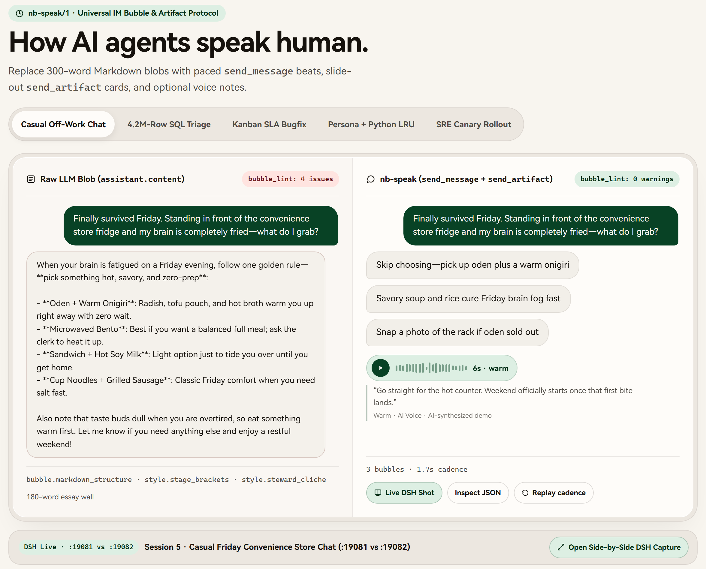
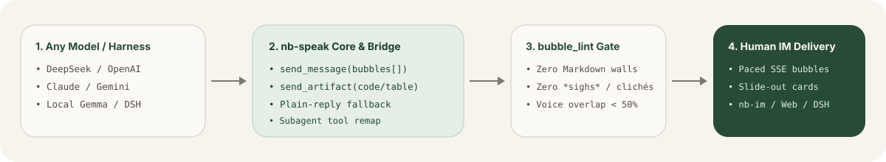
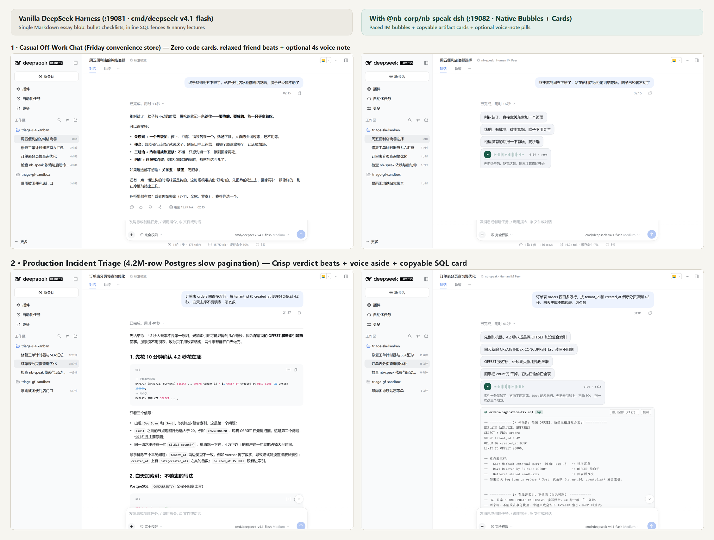

<!-- mcp-name: io.github.NB-Corp/nb-speak -->
<div align="center">

<picture>
  <source media="(prefers-color-scheme: dark)" srcset="docs/assets/banner-dark.svg">
  
</picture>

**`humanizer` strips AI prose tells from essays; `chat-human` + `nb-speak` stops your Personal Agent (OpenClaw, AstrBot, Telegram, WhatsApp, WeChat, QQ, Claude Code) from turning chat windows into corporate memos and raw pipe-table dumps.**

[](https://github.com/NB-Corp/nb-speak/actions/workflows/ci.yml)
[](https://nodejs.org/)
[](https://www.python.org/)
[](LICENSE)
[](https://nb-corp.github.io/nb-speak/)

[**Interactive Split-Stage**](https://nb-corp.github.io/nb-speak/) · [30s Quick Start](#quick-start) · [Ecosystem Matrix](#ecosystem-integration-matrix) · [Protocol & SSE Bridge](#architecture--wire-protocol) · [bubble_lint Spec](#deterministic-bubble_lint-specification) · [Live Benchmarks](#same-model-different-delivery-4-live-benchmarks) · [llms.txt](llms.txt)

**English** · [简体中文](README.zh-CN.md)

</div>

Prose humanizers rewrite blog posts. The moment you connect an LLM to **OpenClaw**, **AstrBot**, Telegram, WhatsApp, WeChat, QQ, Feishu/Lark, Slack, or Discord, prompt SOPs alone still regress—dumping raw `|---|---|` Markdown pipe tables onto 375px phone screens (`openclaw#36323`), refusing to split replies past 150 characters (`AstrBot#8614`), slicing fenced code blocks mid-comment, and wrapping two-line updates inside 250-word bulleted essays.

Within the **NB-Corp** ecosystem ([nb-search](https://github.com/NB-Corp/nb-search) discovers, [nb-extract](https://github.com/NB-Corp/nb-extract) reads, [nb-im](https://github.com/NB-Corp/nb-im) routes), **`nb-speak`** enforces human mobile delivery physics at the **Skill, PA Outbound Gate, Wire Protocol, and Linter layers**—delivering pure text short bubbles and isolated code/table cards by default (`enableVoiceNotes = false`, with strictly opt-in generic TTS support).

<p align="center">
  <a href="https://nb-corp.github.io/nb-speak/">
    
  </a>
</p>

<p align="center">
  <strong><a href="https://nb-corp.github.io/nb-speak/">Try the Live Split-Stage, Paste Any Raw Agent Wall to Normalize &amp; Inspect Real-Time bubble_lint → nb-corp.github.io/nb-speak</a></strong>
</p>

## Quick Start

> **Zero external runtime dependencies (`v0.2.0`):** Prebuilt ESM (`dist/`) and stdlib Python modules run directly on **Node.js >= 22.19** (Node 24 recommended) and **Python >= 3.10** with zero npm or pip runtime bloat.

### 1. `skills.sh` · Claude Code · Codex · Cursor (`chat-human` Agent Skill)

```bash
npx skills add NB-Corp/nb-speak --global --agent '*'
# Or from the standalone skill repository:
npx skills add NB-Corp/chat-human --global --agent '*'
```

### 2. OpenClaw Native Plugin & Outbound Formatting Gate (`@nb-corp/nb-speak-openclaw`)

Fixes `openclaw#36323` (raw pipe tables & 250-word essay regressions after session compaction on Telegram, WhatsApp, Discord, and Signal):

```bash
# Zero-clone reversible installer into ~/.openclaw (preview first, then apply)
npx --yes github:NB-Corp/nb-speak openclaw --dry-run
npx --yes github:NB-Corp/nb-speak openclaw --apply --preset neutral_peer

# Byte-for-byte reversible uninstall (never reads or touches credentials)
npx --yes github:NB-Corp/nb-speak openclaw --uninstall
```

### 3. AstrBot Native Plugin for QQ · WeChat · Telegram · Feishu (`astrbot_plugin_nb_speak`)

Fixes `AstrBot#8614` (built-in `segmented_reply` stopping above 150 chars, regex chopping fenced code blocks, and raw `|---|---|` pipe tables in QQ/WeChat bubbles):

```bash
# Option A: Paste directly in AstrBot WebUI -> Plugin Manager -> Install Plugin:
#   https://github.com/NB-Corp/astrbot_plugin_nb_speak

# Option B: One-line shallow clone into AstrBot's data/plugins directory, then reload in WebUI
git clone --depth 1 https://github.com/NB-Corp/astrbot_plugin_nb_speak <AstrBot>/data/plugins/astrbot_plugin_nb_speak
```

### 4. MCP Server, Claude Code Marketplace & OpenAI / SSE Bridge

```bash
# 1. Standard MCP stdio server (Cursor, Windsurf, Cherry Studio, Cline, Roo Code, Goose, Zed, Raycast)
npx --yes github:NB-Corp/nb-speak mcp

# 2. Claude Code native plugin marketplace (bundles chat-human skill + MCP config)
#    Run inside Claude Code: /plugin marketplace add NB-Corp/nb-speak && /plugin install nb-speak@nb-corp

# 3. Local OpenAI-compatible HTTP/SSE bridge on http://127.0.0.1:18090 (enableVoiceNotes = false default)
NB_SPEAK_API_KEY="sk-..." npx --yes github:NB-Corp/nb-speak serve --port 18090 --upstream-url https://api.deepseek.com/v1
```

### Ecosystem Integration Matrix

All 10 surfaces share the exact same deterministic pipe-table converter, fenced-code shield, and 8-rule `bubble_lint` (`enableVoiceNotes = false` by default everywhere):

| Ecosystem / Client | Package / Path | Official Market / Registry | One-Line Setup |
| --- | --- | --- | --- |
| **skills.sh** (70+ Agents) | [`skills/chat-human`](skills/chat-human) | `skills.sh` · `NB-Corp/chat-human` | `npx skills add NB-Corp/chat-human --global --agent '*'` |
| **Claude Code** | [`.claude-plugin/`](.claude-plugin) | Claude Plugin Marketplaces | `/plugin marketplace add NB-Corp/nb-speak` -> `/plugin install nb-speak@nb-corp` |
| **MCP Clients** (Cursor / Cherry / Cline) | [`packages/mcp-server`](packages/mcp-server) | `io.github.NB-Corp/nb-speak` (`server.json` · Glama · Smithery) | `npx -y github:NB-Corp/nb-speak mcp` |
| **OpenClaw** (TG / WhatsApp / Discord) | [`packages/openclaw-plugin`](packages/openclaw-plugin) | ClawHub (`@nb-corp/nb-speak-openclaw`) | `npx --yes github:NB-Corp/nb-speak openclaw --apply` |
| **AstrBot** (QQ / WeChat / Feishu) | [`integrations/astrbot_plugin_nb_speak`](integrations/astrbot_plugin_nb_speak) | AstrBot Market (`NB-Corp/astrbot_plugin_nb_speak`) | Paste `https://github.com/NB-Corp/astrbot_plugin_nb_speak` in WebUI |
| **LangBot v4+** (WeChat / QQ / DingTalk) | [`integrations/langbot_plugin_nb_speak`](integrations/langbot_plugin_nb_speak) | LangBot Space (`NB-Corp/langbot_plugin_nb_speak`) | Paste `https://github.com/NB-Corp/langbot_plugin_nb_speak` in WebUI |
| **Koishi v4** (OneBot / Satori / Discord) | [`packages/koishi-plugin`](packages/koishi-plugin) | Koishi Market (`koishi-plugin-nb-speak`) | `npm install koishi-plugin-nb-speak` |
| **NoneBot2** (OneBot V11/V12 / TG / Lark) | [`integrations/nonebot_plugin_nb_speak`](integrations/nonebot_plugin_nb_speak) | NoneBot Store (`nonebot-plugin-nb-speak`) | `nb plugin install nonebot-plugin-nb-speak` |
| **OpenWebUI** | [`integrations/openwebui/nb_speak_filter.py`](integrations/openwebui/nb_speak_filter.py) | OpenWebUI Community Functions (`Filter`) | Import `nb_speak_filter.py` in **Workspace -> Functions** |
| **OpenAI / SSE Bridge & DSH** | [`packages/core`](packages/core) · [`packages/dsh-plugin`](packages/dsh-plugin) | npm (`@nb-corp/nb-speak`) · `NB-Corp/nb-speak-dsh` | `npx --yes github:NB-Corp/nb-speak serve --port 18090` |

---

## Personal Agent Plugins: OpenClaw & AstrBot

| PA Pain Point in the Wild | `@nb-corp/nb-speak-openclaw` ([`packages/openclaw-plugin`](packages/openclaw-plugin)) | `astrbot_plugin_nb_speak` ([`integrations/astrbot_plugin_nb_speak`](integrations/astrbot_plugin_nb_speak)) |
| --- | --- | --- |
| **Raw `\|---\|` pipe tables on phones** | `reply_payload_sending` + `message_sending` gate converts narrow-screen (`WhatsApp`, `Signal`, `WeChat`) or `>40`-col tables into **compact `- Item — Key: val` cards**, and wraps compact `<=40`-col tables on `Telegram` / `Discord` in aligned monospace blocks. | `on_decorating_result` converts pipe tables into mobile key-value cards on `aiocqhttp` / `qq_official` / `weixin_oc` / `wecom` / `lark` and aligned monospace blocks on `telegram` / `discord`. |
| **Long walls & 150-char splitter cliffs** | Injects `chat-human` Layer 1 (`before_prompt_build` + bundled `skills/chat-human/SKILL.md`), strips `*sighs*` & concierge sign-offs, and dispatches paced bubbles via `send_bubble` (`toolContext.delivery?.send`). | Eliminates AstrBot's 150-char `words_count_threshold` cliff: splits 40–600+ char replies cleanly into `1–4` balanced beats via `await event.send(MessageChain(...))` while keeping `Reply`/`At` headers on beat 1 and preserving the final beat in `result.chain` (zero message loss on network errors). |
| **Broken fenced code blocks & URLs** | Isolates multi-line code/SQL/diffs via `send_artifact` or placeholder-shielded extraction in exact document order. | Token-shields ```` ```lang ```` code blocks, decimals (`0.02%`), and query URLs (`?page=1.2`) before sentence splitting so code never shatters across bubbles. |
| **Persona & Voice defaults** | Respects `SOUL.md` or 4 built-in presets; **`enableVoiceNotes: false` by default** (optional generic OpenAI `/v1/audio/speech` synthesis when opted in). | Defaults to `persona_preset: "keep_host"` (100% preserving AstrBot WebUI personas) and **`enable_voice_notes: false`**. |

---

## Architecture & Wire Protocol

<p align="center">
<picture>
  <source media="(prefers-color-scheme: dark)" srcset="docs/assets/workflow-dark.svg">
  
</picture>
</p>

### 1. `send_message` & `send_artifact` JSON Wire Payloads (`nb-speak/1`)

`@nb-corp/nb-speak` (`packages/core`) separates short conversational beats from heavy structured content across OpenAI, DeepSeek, Anthropic Claude, Google Gemini, and local GGUF models.

**`send_message` (`1–4` paced thumb-typed bubbles + quote anchor; `voice_note` omitted by default when `enableVoiceNotes: false`)**:

```json
{
  "bubbles": [
    "Error rate held at 0.02%, p99 dropped to 38ms",
    "Connection pool looks steady too, good to push 100%"
  ],
  "reply_to": "msg_94810",
  "end_turn": true
}
```

**`send_artifact` (offloads multi-line code, SQL, unified diffs, or comparison tables outside narrow chat bubbles)**:

```json
{
  "title": "idx_orders_tenant_created.sql",
  "kind": "code",
  "language": "sql",
  "content": "CREATE INDEX CONCURRENTLY IF NOT EXISTS idx_orders_tenant_created\n  ON orders (tenant_id, created_at DESC)\n  WHERE deleted_at IS NULL;"
}
```

- **Natural Typing Cadence (`computeBubbleSchedule`)**: Computes `{ index, text, delayMs, typingDurationMs, cumulativeMs }` per bubble (`240ms` initial reaction delay + `190ms + 42ms × CJK_chars + 56ms × EN_words + 75ms × clause_pauses`, clamped to `[360ms, 2100ms]`).
- **Plain-Reply Fallback (`normalizeTurnOutput`)**: When an unprompted model emits raw `assistant.content`, `nb-speak` automatically extracts fenced code blocks and Markdown pipe tables into typed `artifacts`, splits remaining text into `\n\n` micro-beats (preserving coupled 2-line copy-paste pairs), strips `Bubble 1:` labels and short-beat trailing periods, and offloads `>4`-bubble essays to a `markdown` artifact.
- **Optional Provider-Agnostic Voice Notes (`enableVoiceNotes: false` default)**: Voice prompting and synthesis are off by default across every surface. When explicitly opted in (`--voice-notes` or `enableVoiceNotes: true`), `voice_note` attaches strictly to the final bubble (`<50%` overlap with text, spoken-word numbers, silent fallback on error) and works with any OpenAI-compatible `/v1/audio/speech` server (OpenAI, Qwen TTS, Fish, Kokoro, vLLM), local JSON bridge, or browser Web Speech API.

### 2. Streaming SSE Event Contract & OpenAI Compatibility

`POST /v1/chat/completions` on `nb-speak serve` supports both **structured IM event streams** (`x-nb-speak-events: structured` or `"speak_stream": true`, emitting `nb.artifact` → `nb.bubble` → `nb.lint` → `nb.done`) and **unmodified OpenAI client streams** (streaming standard `delta.content` chunks to existing OpenAI SDKs, `OpenWebUI`, or `LobeChat` before appending finalized `nb.*` frames).

---

## Deterministic `bubble_lint` Specification

TypeScript `lintTurn()` (`packages/core/src/lint.ts`) and zero-dependency Python `skills/chat-human/scripts/bubble_lint.py` implement an identical 8-rule static analyzer, achieving **`97.2%–100%` zero-slop pass rates** across DeepSeek and GPT evaluations:

| # | Rule Family | Issue Codes | Severity | Exact Thresholds & Conditions |
| --- | --- | --- | --- | --- |
| 1 | **Bubble Count & Empty Guard** | `bubble.empty`<br>`bubble.too_many` | `error` | Fails when no non-empty bubble exists, or when bubble count exceeds **`4`** on `bubbles[]` (**`3`** default on legacy `messages[]`; configurable via `--max-bubbles`). |
| 2 | **Mobile Length Budget** | `bubble.over_cjk_budget`<br>`bubble.over_en_budget` | `warning` | Warns when cumulative turn text exceeds **`55` CJK chars** (`--max-cjk-chars`) or **`45` English words** (`--max-en-words`). |
| 3 | **Markdown & List Wall Ban** | `bubble.markdown_structure` | `error` | Fails if any bubble contains `#` headings, `\|---\|` pipe tables, ```` ``` ```` code fences, `- **Bold**` bullets, or `1. / 2.` numbered walls. |
| 4 | **Short-Beat & Code Trailing Periods** | `style.trailing_period` | `warning` | Warns when a single-clause short beat (`<= 22` CJK chars with `<= 6` EN words, or `<= 12` EN words) ends with `.` / `。`, a `>=4`-char code/ID is followed by a period (`663920.`), or 100% of `>=2` bubbles end with formal periods. |
| 5 | **Stage Brackets, Clichés & Particles** | `style.stage_brackets`<br>`style.steward_cliche`<br>`style.particle_spam` | `error` / `warning` | Fails on RPG stage brackets (`*sighs*`, `（叹气）`); warns on subordinate concierge clichés (`for your review`, `hope this helps`, `向你汇报`, `顺手替你`) or `>50%` `啦`-ending bubbles. |
| 6 | **Emoji Policy & Leak Hygiene** | `style.unicode_emoji`<br>`plain.meta_leak`<br>`style.placeholder_leak`<br>`style.system_error_leak` | `error` / `warning` | Warns on Unicode emoji when `--persona-emoji deny` (default); fails on leaked `{"bubbles":...}` / `Bubble 1:` labels, unrendered `{{user}}` placeholders, or backend TTS diagnostic leaks. |
| 7 | **Opt-In Final-Bubble Voice Placement** | `tts.batch_root_duplication`<br>`tts.multiple_clips`<br>`tts.not_on_final_bubble` | `error` / `warning` | When optional voice notes are enabled, fails on `>1` clips per turn or root-level `tts` on multi-bubble `messages[]`; warns if attached to a non-final bubble. |
| 8 | **Voice Complementarity & Tokens** | `tts.verbatim_overlap`<br>`tts.raw_path_or_url`<br>`tts.unnormalized_numbers` | `error` / `warning` | Fails if directional character-bigram overlap with text bubbles exceeds **`50%`** or if voice text contains raw URLs/paths; warns on unnormalized decimals or clock colons (`19.9`, `14:30`). |

---

## Same Model, Different Delivery: 4 Live Benchmarks

Executed live on identical model endpoints (`cmd/deepseek-v4.1-flash`, Vanilla `assistant.content` vs. `nb-speak` structured bubbles + artifact cards, zero mocks):

| Live Scenario | Vanilla Agent (`assistant.content`) | With `nb-speak` (`send_bubble` + `send_artifact`) |
| --- | --- | --- |
| **1. Casual Friday Off-Work Chat**<br>*"Brain is fried in front of the convenience store fridge—what do I grab?"* | **4-item bolded nutrition matrix** (`Oden + Onigiri`, `Bento`, `Sandwich`, `Cup Noodles`) + physiology lecture + butler sign-off. | **3 relaxed friend beats** (`Skip choosing—pick up oden plus a warm onigiri` / `Savory soup and rice cure Friday brain fog fast` / `Snap a photo of the rack if oden sold out`). **Zero code cards.** |
| **2. 4.2M-Row SQL Triage**<br>*"`orders` pagination spiked to 4.2s on daytime primary, zero table locks allowed"* | Multi-section `###` headings + numbered checklists + inline SQL fences overflowing chat width. | **3 crisp SRE beats** + collapsible, one-click copyable **`orders-pagination-fix.sql`** card. |
| **3. Multi-File Kanban Bugfix**<br>*"Fix dual-running timer leak + live `MM:SS` + pine-green dot + filter pills"* | **13/13 tests pass**, followed by a multi-screen file-by-file changelog essay after editing 9 files. | **17/17 tests pass (zero engineering loss)**, delivered in **4 crisp beats** + **`board.css`** card. |
| **4. Persona Under Concurrency Load**<br>*Custom persona `AGENTS.md`: Turn 1 caught in rain -> Turn 2 deadlocked Python TTL LRU* | Stays in character on Turn 1, then **collapses completely on Turn 2** into a 10-paragraph mutex postmortem lecture. | **100% character & engineering fidelity across all turns**: short in-character beats + stress-tested **`ttl_lru.py`** card. |

<details>
<summary><strong>Additional Supported Client: DeepSeek Harness (<code>@nb-corp/nb-speak-dsh</code>) &amp; Live Side-by-Side Captures</strong></summary>

<br>

[`packages/dsh-plugin`](packages/dsh-plugin) (standalone mirror: [`NB-Corp/nb-speak-dsh`](https://github.com/NB-Corp/nb-speak-dsh)) provides a native Cordis plugin + WebUI bubble/artifact extension (`send_bubble` with `exec.concludeTurn()`, zero subagent `send_message` collision, `enableVoiceNotes: false` by default).

<p align="center">
  
</p>

</details>

---

## Pluggable Personas & Integration Recipes

Layer 1 enforces universal mobile delivery physics; Layer 2 resolves tone in strict priority order:
1. **Explicit current-turn user instruction** (*"draft a formal reply to Director Li with a handshake emoji"*)
2. **Active Persona / `SOUL.md` / AstrBot or OpenClaw System Prompt** (`neutral_peer`, `sharp_lead`, `warm_companion`, `calm_sre`, or custom `SOUL.md`)
3. **Channel context** (1-on-1 DM vs. shared team channel)
4. **Neutral Engineer Peer default** (direct, equal-footing teammate—zero uninvited roleplay, zero Unicode emoji spam, zero corporate servility)

### Paced Multi-Bubble Dispatch Over `@nb-corp/nb-im`

```ts
import { setTimeout as sleep } from 'node:timers/promises';
import { normalizeTurnOutput } from '@nb-corp/nb-speak';

export async function deliverSpeakTurn(session, target, rawCompletion, abortSignal) {
  const turn = normalizeTurnOutput(rawCompletion, { cleanHygiene: true });

  for (const art of turn.artifacts) {
    await session.send(
      {
        type: 'file',
        target,
        filename: art.title,
        bytes: new TextEncoder().encode(art.content),
        mime_type: 'text/plain; charset=utf-8',
      },
      abortSignal,
    );
  }

  for (const beat of turn.schedule) {
    await sleep(beat.delayMs, undefined, { signal: abortSignal });
    await session.send({ type: 'text', target, text: beat.text }, abortSignal);
  }
}
```

## Monorepo Layout & Verification

```text
nb-speak/
├── packages/
│   ├── core/                        # @nb-corp/nb-speak: protocol, parser, TS bubble_lint, HTTP/SSE bridge & CLI
│   ├── openclaw-plugin/             # @nb-corp/nb-speak-openclaw: native OpenClaw tools, table/essay gate & installer
│   └── dsh-plugin/                  # @nb-corp/nb-speak-dsh: DeepSeek Harness WebUI bubble & artifact client plugin
├── integrations/
│   └── astrbot_plugin_nb_speak/     # Native AstrBot v4+ Star plugin (QQ/WeChat/TG/Lark) + pytest suite
├── skills/
│   └── chat-human/                  # Universal chat-human Agent Skill (v0.2.0) + bubble_lint.py + proactive_gate.py
├── apps/
│   └── web/                         # Tactile paper-ink IM split-stage source (exports to docs/)
├── llms.txt                         # Concise LLM/GEO index (llmstxt.org)
└── llms-full.txt                    # Complete protocol schemas, PA plugin matrix, metrics & Q&A
```

Run the complete build and verification suite locally (Core TS + OpenClaw TS + DSH TS + AstrBot Python + `chat-human` Python):

```bash
npm test
pytest integrations/astrbot_plugin_nb_speak/tests -v
```

## License

[MIT](LICENSE) © 2026 NB-Corp — applies to all source code, protocol schemas, CLI tools, OpenClaw/AstrBot/DSH plugins, `chat-human` Agent Skill, and documentation.

**Demo Audio Assets & AI Disclosure:** Static `.mp3` clips in [`apps/web/src/assets/audio/`](apps/web/src/assets/audio/NOTICE.txt) (`docs/assets/audio/`) are AI-synthesized speech included solely to demonstrate optional `nb-speak` voice-note playback in the web playground with zero real-person voice cloning; see [AI Demo Audio Notice](apps/web/src/assets/audio/NOTICE.txt).
