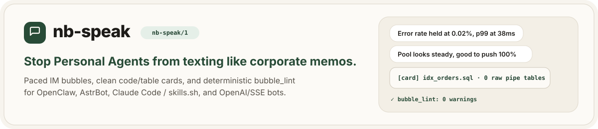

<div align="center">

<picture>
  <source media="(prefers-color-scheme: dark)" srcset="docs/assets/banner-dark.svg">
  
</picture>

**Universal `send_message` + `send_artifact` IM bubble protocol, zero-dependency OpenAI/SSE bridge, DeepSeek Harness plugin, tactile paper-ink playground, and `chat-human` Agent Skill.**

[](https://github.com/NB-Corp/nb-speak/actions/workflows/ci.yml)
[](https://nodejs.org/)
[](https://www.python.org/)
[](LICENSE)
[](https://nb-corp.github.io/nb-speak/)

[Live Playground](https://nb-corp.github.io/nb-speak/) · [Quick start](#quick-start) · [Wire Protocol & SSE](#wire-protocol--sse-contract) · [DSH Plugin](#deepseek-harness-plugin-nb-corpnb-speak-dsh) · [bubble_lint Spec](#deterministic-bubble_lint-specification) · [Recipes](#integration-recipes) · [llms.txt](llms.txt) · [nb-im](https://github.com/NB-Corp/nb-im)

**English** · [简体中文](README.zh-CN.md)

</div>

Every mainstream AI chat client and agent harness today dumps 250-word Markdown essays as a single `assistant.content` blob—cramming SQL queries and pipe tables inside narrow phone bubbles, repeating the concierge *"Got it! + Here is everything I did! + Go get some rest!"* triad, and reading text bubbles word-for-word in TTS voice notes.

Within the **NB-Corp** ecosystem ([nb-search](https://github.com/NB-Corp/nb-search) discovers, [nb-extract](https://github.com/NB-Corp/nb-extract) reads, [nb-hub](https://github.com/NB-Corp/nb-hub) signals, [nb-im](https://github.com/NB-Corp/nb-im) routes), **`nb-speak`** is **how AI agents actually speak to humans**:

<p align="center">
<picture>
  <source media="(prefers-color-scheme: dark)" srcset="docs/assets/workflow-dark.svg">
  
</picture>
</p>

## Before vs. After

| Scenario | Raw `assistant.content` Blob | With `nb-speak` (`send_message` + `send_artifact`) |
| --- | --- | --- |
| **SRE canary check** | **165-word essay**: *"You can proceed to 100%, however 25m only covers one slice: 1. Watch DB lock queues... 2. Step to 50% first... \| Metric \| Canary \|... Let me know if you need anything else!"* | **Bubble 1** (`240ms`): `Error rate held at 0.02%, p99 dropped to 38ms` <br>**Bubble 2** (`1.1s`): `Connection pool looks steady too, good to push 100%` <br>**Artifact card**: `auth-canary-25m.md` <br>**Voice note** (`6s`, final bubble): *"Dashboard stayed quiet for twenty-five minutes straight. Flip it whenever you're ready."* |
| **SQL timeout review** | Inline `###` headers + bullet wall + 12-line SQL fence overflowing mobile width + *"Hope this helps!"* | **Bubble 1**: `Postgres is seq-scanning 4.2M rows because tenant_id + created_at lacks a partial index` <br>**Bubble 2**: `Dropped the concurrent migration SQL in the card so writes stay unblocked` <br>**Artifact card**: `idx_orders_tenant_created.sql` |
| **3rd `"final"` tweak** | `*sighs* Frequent requirement changes reduce velocity! I updated the CTA color for your kind review.` | **Bubble 1**: `Third "final" tweak is live on staging` <br>**Bubble 2**: `Forest green CTA is back, take a look and tell me this one sticks` |

<p align="center">
  <a href="https://nb-corp.github.io/nb-speak/">
    
  </a>
</p>

## Quick start

> **Release status (`v0.2.0`):** Distributed directly from GitHub with prebuilt ESM artifacts (`dist/`) and **zero runtime npm/pip dependencies**. Requires **Node.js >= 22.19** (Node 24 recommended); `skills/chat-human` utilities use **Python >= 3.10** stdlib. Every command below runs as shown.

### 1. Install the `chat-human` Agent Skill (Codex, Claude Code, Kiki, Cursor)

```bash
npx skills add NB-Corp/nb-speak
# Or from the standalone skill mirror:
npx skills add NB-Corp/chat-human
```

Or copy [`skills/chat-human`](skills/chat-human) directly into `~/.agents/skills/chat-human` or `~/.claude/skills/chat-human`.

### 2. Lint, Parse, or Serve the OpenAI/SSE Bridge in 30 Seconds

Run directly via `npx --yes github:NB-Corp/nb-speak` or from a local clone:

```bash
git clone https://github.com/NB-Corp/nb-speak.git
cd nb-speak

# 1. Print OpenAI / Anthropic / Gemini tool schemas
node packages/core/bin/nb-speak.mjs tools --provider openai

# 2. Deterministically lint an outbound turn (0 issues -> exit code 0)
echo '{"bubbles":["Error rate held at 0.02%, p99 down to 38ms","Pool looks steady, good to push 100%"]}' \
  | node packages/core/bin/nb-speak.mjs lint --json

# 3. Normalize a raw Markdown + SQL wall into paced bubbles & extracted artifacts
printf 'Bubble 1: Query fixed.\n\n```sql\n-- fix.sql\nSELECT 1;\n```\n\nReady to ship.\n' \
  | node packages/core/bin/nb-speak.mjs parse

# 4. Start the local OpenAI-compatible HTTP/SSE bridge on http://127.0.0.1:18090
NB_SPEAK_API_KEY="sk-..." node packages/core/bin/nb-speak.mjs serve \
  --port 18090 \
  --upstream-url https://api.deepseek.com/v1 \
  --model deepseek-chat \
  --persona calm_sre
```

## Wire Protocol & SSE Contract

`@nb-corp/nb-speak` (`packages/core`) replaces raw Markdown prose dumps with two orthogonal output tools across OpenAI, DeepSeek, Anthropic Claude, Google Gemini, and local Gemma models.

### 1. `send_message` & `send_artifact` JSON Wire Payloads

**`send_message` (`1–4` paced thumb-typed bubbles + optional final-bubble complementary voice note + quote anchor)**:

```json
{
  "bubbles": [
    "Error rate held at 0.02%, p99 dropped to 38ms",
    "Connection pool looks steady too, good to push 100%"
  ],
  "voice_note": {
    "text": "Dashboard stayed quiet for twenty-five minutes straight. Flip it whenever you are ready.",
    "emotion": "calm"
  },
  "reply_to": "msg_94810",
  "end_turn": true
}
```

**`send_artifact` (offloads multi-line code, SQL, unified diffs, or Markdown pipe tables outside narrow chat bubbles)**:

```json
{
  "title": "idx_orders_tenant_created.sql",
  "kind": "code",
  "language": "sql",
  "content": "CREATE INDEX CONCURRENTLY IF NOT EXISTS idx_orders_tenant_created\n  ON orders (tenant_id, created_at DESC)\n  WHERE deleted_at IS NULL;"
}
```

- **Natural Typing Cadence (`computeBubbleSchedule`)**: Computes `{ index, text, delayMs, typingDurationMs, cumulativeMs }` per bubble (`240ms` initial reaction delay + `190ms + 42ms × CJK_chars + 56ms × EN_words + 75ms × clause_pauses`, clamped to `[360ms, 2100ms]`).
- **Plain-Reply Fallback (`normalizeTurnOutput`)**: When an unprompted or plain-reply model emits raw `assistant.content`, `nb-speak` automatically extracts fenced code blocks and Markdown pipe tables into typed `artifacts`, splits remaining text into `\n\n` micro-beats (preserving coupled 2-line copy-paste pairs), strips `Bubble 1:` labels and short-beat trailing periods, and offloads `>4`-bubble essays to a `markdown` artifact.

### 2. Streaming SSE Event Contract & Standard OpenAI `delta.content` Compatibility

`POST /v1/chat/completions` on `nb-speak serve` supports both **structured IM event streams** and **unmodified OpenAI client streams**:

- **Structured Event Mode** (send header `x-nb-speak-events: structured` or body `"speak_stream": true`): suppresses raw partial JSON chunks and streams typed `nb.*` SSE frames in delivery order:

```text
event: nb.artifact
data: {"type":"nb.artifact","index":0,"artifact":{"title":"auth-canary-25m.sql","kind":"code","language":"sql","content":"SELECT ..."}}

event: nb.bubble
data: {"type":"nb.bubble","index":0,"text":"Error rate held at 0.02%, p99 dropped to 38ms","delayMs":240,"typingDurationMs":748,"cumulativeMs":240}

event: nb.bubble
data: {"type":"nb.bubble","index":1,"text":"Connection pool looks steady too, good to push 100%","delayMs":769,"typingDurationMs":769,"cumulativeMs":1009}

event: nb.voice_note
data: {"type":"nb.voice_note","voice_note":{"text":"Dashboard stayed quiet for twenty-five minutes straight. Flip it whenever you are ready.","emotion":"calm"}}

event: nb.lint
data: {"type":"nb.lint","lint":{"ok":true,"issueCount":0,"errorCount":0,"warningCount":0,"stats":{"bubbleCount":2,"totalCjkChars":0,"totalEnWords":19,"hasVoiceNote":true,"ttsOverlap":0.06},"issues":[]}}

event: nb.done
data: {"type":"nb.done","turn":{"source":"tool_calls","bubbles":["..."],"artifacts":[...],"end_turn":true,"schedule":[...],"lint":{...}}}

data: [DONE]
```

- **Standard OpenAI Compatibility Mode** (default when `x-nb-speak-events` is omitted): streams upstream `data: {"choices":[{"delta":{"content":...}}]}` chunks unmodified to existing OpenAI SDKs, `OpenWebUI`, or `LobeChat`, then emits the finalized `nb.*` frames before `data: [DONE]`. Non-streaming requests (`stream: false`) return the standard OpenAI `choices[0].message` response augmented with a top-level `nb_speak` normalized turn object.

## DeepSeek Harness Plugin (`@nb-corp/nb-speak-dsh`)

[`packages/dsh-plugin`](packages/dsh-plugin) provides a native Cordis bundle and loopback OpenAI bridge (default `127.0.0.1:18091`) for DeepSeek Harness (`DSH`).

### 1. Reversible CLI Lifecycle & Isolated `--dsh-home` Sandboxing

`install-dsh.mjs` **never reads, modifies, or deletes `.credentials.yaml`**, snapshotting tracked profile files to `<DSH_HOME>/.nb-speak-backup/<profile>.json` before writing:

```bash
# 1. Dry-run preview (zero filesystem writes)
node packages/dsh-plugin/scripts/install-dsh.mjs --dry-run --profile web

# 2. Test inside an isolated --dsh-home sandbox without touching ~/.dsh
node packages/dsh-plugin/scripts/install-dsh.mjs --apply \
  --dsh-home .tmp/dsh-sandbox \
  --profile web \
  --runtime-mode skill \
  --preset calm_sre \
  --bridge-port 18091

# 3. Apply to your active DSH profile
node packages/dsh-plugin/scripts/install-dsh.mjs --apply --profile web --runtime-mode skill

# 4. Byte-for-byte reversible uninstall
node packages/dsh-plugin/scripts/install-dsh.mjs --uninstall --profile web
```

### 2. Dual Runtime Modes: Mode A (`skill`) vs. Mode B (`voice-model`)

| Capability | Mode A: `skill` (Standard Cloud / Local LLMs) | Mode B: `voice-model` (Split-Phase / 4B Voice Sidecar) |
| --- | --- | --- |
| **Target Models** | `deepseek-v4.1-flash`, `deepseek-chat`, GPT, Claude, Gemini, or any OpenAI-compatible model | Dedicated Split-Phase models or `<0.8s` 4B voice-translator sidecars (`http://127.0.0.1:18088/v1`) |
| **Wire Behavior** | Injects `chat-human` system contract + user-facing `send_message` & `send_artifact`, rendering user bubbles & cards into DSH `assistant.content` | Encodes continuous 5-axis weights into `nb-speak-voice-v1\|w0,w1,w2,w3,w4` and expands spoken single newlines to `\n\n` paragraphs via `BubbleStreamFormatter` (keeping code fences intact) |
| **Best For** | Zero extra GPU infra; instant human IM delivery on standard cloud APIs | Sub-second companion gateways or multi-LoRA continuous voice mixing |

### 3. Subagent `send_message <-> agent_send_message` Collision Avoidance

DSH reserves an internal tool named `send_message` for parent-to-subagent orchestration. Exposing a user-facing `send_message({ bubbles })` tool directly would collide with subagent dispatch.

`@nb-corp/nb-speak-dsh` (`src/tool-remap.ts`) eliminates this collision via per-request bidirectional remapping:
1. **Outbound to Upstream Model**: DSH's internal `send_message` tool schema and historical subagent `tool_calls` are rewritten to `agent_send_message` (alongside `send_artifact` -> `ext_send_artifact` and `send_code_or_doc` -> `ext_send_code_or_doc`), freeing `send_message` for user-facing chat bubbles.
2. **Inbound back to DSH**: User-facing `send_message` / `send_artifact` calls are consumed by the bridge into formatted user-visible beats, while any `agent_send_message` tool calls emitted by the model are restored back to `send_message` for DSH's subagent runtime.

### 4. 5-Axis Continuous Style Budget & Custom `SOUL.md`

Switch built-in presets (`neutral_peer`, `sharp_lead`, `warm_companion`, `calm_sre`), supply a custom `customSoul` (`SOUL.md`) prompt override, or set `preset: custom` to blend 5 continuous axes:

| Axis | Config Key | Range | Default (`neutral_peer`) | Role |
| --- | --- | --- | --- | --- |
| `w0` | `clarity` | `0.00 – 1.25` | `1.00` | Base factual directness & ship/hold clarity (exempt from filter clamping) |
| `w1` | `warmth` | `0.00 – 1.25` | `0.20` | Conversational warmth & close-peer attentiveness |
| `w2` | `sharp_wit` | `0.00 – 1.25` | `0.10` | Dry understatement & candid pushback |
| `w3` | `calm_grounding` | `0.00 – 1.25` | `0.20` | Low-pulse incident & on-call steadiness |
| `w4` | `concise_cadence` | `0.00 – 1.25` | `0.30` | Mobile subject-ellipsis & short-beat brevity bias |

- **`L1 <= 1.15` Filter Budget Projection**: Whenever `w1 + w2 + w3 + w4 > 1.15` (`BUDGET_LIMIT`), `computeEffectiveWeights()` proportionally scales `w1..w4` so their sum stays `<= 1.15`, preventing multi-adapter over-saturation.

## Deterministic `bubble_lint` Specification

TypeScript `lintTurn()` (`packages/core/src/lint.ts`) and zero-dependency Python `skills/chat-human/scripts/bubble_lint.py` implement an identical 8-rule static analyzer, achieving **`97.2%–100%` zero-slop pass rates** across DeepSeek and GPT evaluations:

| # | Rule Family | Issue Codes | Severity | Exact Thresholds & Conditions |
| --- | --- | --- | --- | --- |
| 1 | **Bubble Count & Empty Guard** | `bubble.empty`<br>`bubble.too_many` | `error` | Fails when no non-empty bubble or voice note exists, or when bubble count exceeds **`4`** on `bubbles[]` (**`3`** default on legacy `messages[]`; configurable via `--max-bubbles`). |
| 2 | **Mobile Length Budget** | `bubble.over_cjk_budget`<br>`bubble.over_en_budget` | `warning` | Warns when cumulative turn text exceeds **`55` CJK chars** (`--max-cjk-chars`) or **`45` English words** (`--max-en-words`). |
| 3 | **Markdown & List Wall Ban** | `bubble.markdown_structure` | `error` | Fails if any bubble contains `#` headings, `\|---\|` pipe tables, ```` ``` ```` code fences, `- **Bold**` bullets, or `1. / 2.` numbered walls. |
| 4 | **Short-Beat & Code Trailing Periods** | `style.trailing_period` | `warning` | Warns when a single-clause short beat (`<= 22` CJK chars with `<= 6` EN words, or `<= 12` EN words) ends with `.` / `。`, a `>=4`-char code/ID is followed by a period (`663920.`), or 100% of `>=2` bubbles end with formal periods. |
| 5 | **Stage Brackets, Clichés & Particles** | `style.stage_brackets`<br>`style.steward_cliche`<br>`style.particle_spam` | `error` / `warning` | Fails on RPG stage brackets (`*sighs*`, `（叹气）`); warns on subordinate concierge clichés (`for your review`, `hope this helps`, `向你汇报`, `顺手替你`) or `>50%` `啦`-ending bubbles. |
| 6 | **Emoji Policy & Leak Hygiene** | `style.unicode_emoji`<br>`plain.meta_leak`<br>`style.placeholder_leak`<br>`style.system_error_leak` | `error` / `warning` | Warns on Unicode emoji when `--persona-emoji deny` (default); fails on leaked `{"bubbles":...}` / `Bubble 1:` labels, unrendered `{{user}}` placeholders, or backend TTS diagnostic leaks. |
| 7 | **Final-Bubble Voice Placement** | `tts.batch_root_duplication`<br>`tts.multiple_clips`<br>`tts.not_on_final_bubble` | `error` / `warning` | Fails on `>1` voice notes per turn or root-level `tts`/`voice_mode` on multi-bubble `messages[]`; warns if a voice note is attached to a non-final bubble. |
| 8 | **Voice Complementarity & Tokens** | `tts.verbatim_overlap`<br>`tts.raw_path_or_url`<br>`tts.unnormalized_numbers` | `error` / `warning` | Fails if directional character-bigram overlap with text bubbles exceeds **`50%`** (`--max-tts-overlap 0.50`) or if voice text contains raw URLs/paths; warns on unnormalized decimals or clock colons (`19.9`, `14:30`). |

**CLI Exit Codes** (`nb-speak lint` & `bubble_lint.py`):
- `0` — Passed with `0` issues
- `1` — One or more lint errors or warnings reported
- `2` — Invalid CLI flags or malformed JSON input

## Integration Recipes

### Recipe 1: Paced Multi-Bubble + Voice Dispatch Over `@nb-corp/nb-im`

Wire `normalizeTurnOutput()` directly into an [`@nb-corp/nb-im`](https://github.com/NB-Corp/nb-im) session (`telegram`, `feishu`, `slack`, `discord`, `matrix`, `wechat`) so humans receive naturally paced beats instead of instant walls:

```ts
import { setTimeout as sleep } from 'node:timers/promises';
import { normalizeTurnOutput } from '@nb-corp/nb-speak';

export async function deliverSpeakTurn(session, target, rawCompletion, synthesizeTts, abortSignal) {
  const turn = normalizeTurnOutput(rawCompletion, { cleanHygiene: true });

  // 1. Offload code, SQL, diffs, or tables outside narrow chat bubbles
  for (const art of turn.artifacts) {
    await session.send(
      {
        type: 'file',
        target,
        filename: art.title,
        bytes: new TextEncoder().encode(art.content),
        mime_type: 'text/plain; charset=utf-8',
      },
      abortSignal,
    );
  }

  // 2. Pace text bubbles using computeBubbleSchedule's thumb-typing delayMs
  for (const beat of turn.schedule) {
    await sleep(beat.delayMs, undefined, { signal: abortSignal });
    await session.send({ type: 'text', target, text: beat.text }, abortSignal);
  }

  // 3. Send complementary voice note on the final beat; fall back silently if TTS fails
  if (turn.voice_note && synthesizeTts) {
    try {
      const audioBytes = await synthesizeTts(turn.voice_note.text, turn.voice_note.emotion);
      await session.send(
        { type: 'voice', target, bytes: audioBytes, mime_type: 'audio/ogg; codecs=opus' },
        abortSignal,
      );
    } catch {
      // Layer 1 rule: never leak TTS backend/provider errors into user chat text
    }
  }
}
```

### Recipe 2: Cloud Reasoning Brain + Local 4B Voice Translator Sidecar (`--voice-sidecar-url`)

Pair a heavy reasoning endpoint (`deepseek-reasoner`, `deepseek-v4.1-flash`, or any plain-reply workflow) with a local `<0.8s` `llama-server` / vLLM 4B voice-translator sidecar that rewrites plain-text drafts into natural `\n\n` mobile beats automatically:

```bash
# Terminal 1: Start local 4B voice-translator sidecar on port 18088
llama-server -m ./models/voice-translator-4b-q4_k_m.gguf --port 18088

# Terminal 2: Start nb-speak bridge chaining upstream reasoning -> local voice sidecar
NB_SPEAK_API_KEY="sk-..." node packages/core/bin/nb-speak.mjs serve \
  --port 18090 \
  --upstream-url https://api.deepseek.com/v1 \
  --model deepseek-reasoner \
  --voice-sidecar-url http://127.0.0.1:18088/v1
```

## Pluggable Personas: One Mechanics Layer, Any Voice

`nb-speak` never locks your agent into a hardcoded roleplay personality. Layer 1 enforces universal mobile delivery physics; Layer 2 resolves tone in strict priority order:

1. **Explicit current-turn user instruction** (*"draft a formal reply to Director Li with a handshake emoji"*)
2. **Active Persona / `SOUL.md` / System Prompt** (`neutral_peer`, `sharp_lead`, `warm_companion`, `calm_sre`, or custom `SOUL.md`)
3. **Channel context** (1-on-1 DM vs. shared team channel)
4. **Neutral Engineer Peer default** (direct, equal-footing teammate—zero uninvited roleplay, zero Unicode emoji spam, zero corporate servility)

## Monorepo Layout & Verification

```text
nb-speak/
├── packages/
│   ├── core/                # @nb-corp/nb-speak: protocol, parser, TS bubble_lint, HTTP/SSE bridge & CLI
│   └── dsh-plugin/          # @nb-corp/nb-speak-dsh: dual-mode DSH plugin, tool-remap & reversible installer
├── skills/
│   └── chat-human/          # Universal chat-human Agent Skill (v0.2.0) + bubble_lint.py + proactive_gate.py
├── apps/
│   └── web/                 # Tactile warm paper-ink IM web app source (exports to docs/)
├── docs/                    # GitHub Pages live playground (EN + zh-CN), SEO metadata & visual assets
├── llms.txt                 # Concise LLM/GEO index (llmstxt.org)
└── llms-full.txt            # Complete protocol schemas, metrics, comparison matrix & Q&A
```

Run the complete build and test suite locally (Node.js + Python stdlib, zero external packages):

```bash
npm test
```

## License

[MIT](LICENSE) © 2026 NB-Corp
