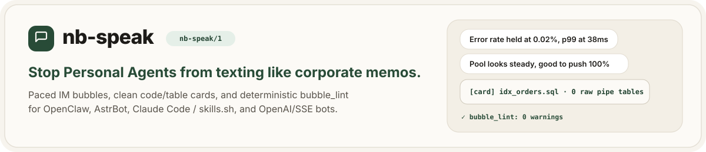
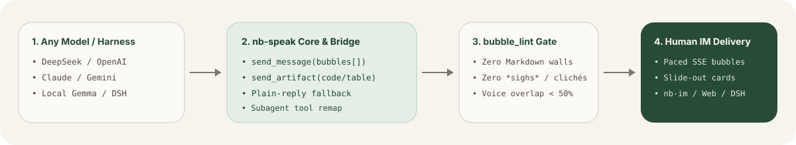
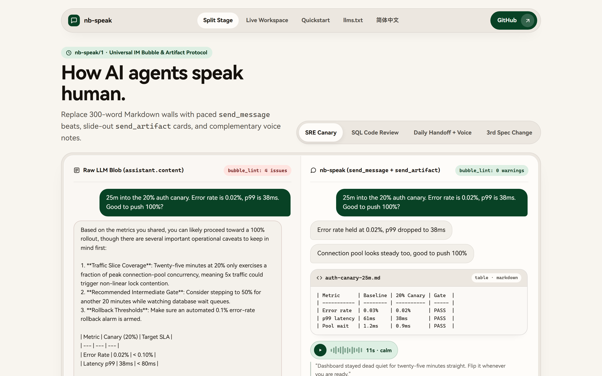

<div align="center">

<picture>
  <source media="(prefers-color-scheme: dark)" srcset="docs/assets/banner-dark.svg">
  
</picture>

**通用 `send_message` + `send_artifact` IM 短气泡协议、零依赖 OpenAI/SSE 桥接网关、DeepSeek Harness 插件、纸墨触感实时对比工作台与 `chat-human` Agent Skill。**

[](https://github.com/NB-Corp/nb-speak/actions/workflows/ci.yml)
[](https://nodejs.org/)
[](https://www.python.org/)
[](LICENSE)
[](https://nb-corp.github.io/nb-speak/zh/)

[在线同屏对比](https://nb-corp.github.io/nb-speak/zh/) · [30 秒快速开始](#快速开始) · [双工具协议](#协议与核心能力-nb-corpnb-speak) · [DSH 插件](#deepseek-harness-插件-nb-corpnb-speak-dsh) · [nb-im (消息通道)](https://github.com/NB-Corp/nb-im)

[English](README.md) · **简体中文**

</div>

今天几乎所有 AI 对话面板与 Agent 框架，都把每次回复当成单块 300 字 Markdown 论文倾倒进 `assistant.content`——把 SQL 与宽表格硬塞进狭窄手机气泡、反复套用「热情接球 + 逐条邀功汇报 + 催吃饭催睡觉」全能管家三件套、甚至在 TTS 语音条里把刚发的文字一字不差重新朗读一遍。

在 **NB-Corp** 工具矩阵中（[nb-search](https://github.com/NB-Corp/nb-search) 负责发现，[nb-extract](https://github.com/NB-Corp/nb-extract) 负责精读，[nb-hub](https://github.com/NB-Corp/nb-hub) 负责信号唤醒，[nb-im](https://github.com/NB-Corp/nb-im) 负责多平台会话路由），**`nb-speak`** 定义了 **AI Agent 如何真正像人类一样开口说话**：

<p align="center">
<picture>
  <source media="(prefers-color-scheme: dark)" srcset="docs/assets/workflow-dark.svg">
  
</picture>
</p>

## 接入前后对比

| 真实场景 | 传统单块 `assistant.content` 输出 | 接入 `nb-speak` (`send_message` + `send_artifact`) |
| --- | --- | --- |
| **SRE 灰度放量确认** | **180 字风险说教墙**：「向你汇报灰度评估结论！但在推全量前请注意三点风险：1. 流量切面覆盖不足…… 2. 建议先推 50%…… \| 指标 \| 灰度 \|…… 请随时检阅！」 | **气泡 1** (`240ms`)：`错误率 0.02% 没动，p99 降到 38ms` <br>**气泡 2** (`980ms`)：`连接池水位也稳，直接推全量吧` <br>**独立制品卡片**：`auth-canary-25m.md` <br>**末尾互补语音条** (`6s`)：*“大盘安安静静跑了快半小时。你那边点完发布就能收工下班啦。”* |
| **SQL 慢查询排查** | 气泡内嵌 `###` 标题 + 加粗列表墙 + 12 行折行错位的 SQL 代码块 + 「希望这对你有帮助！」 | **气泡 1**：`tenant_id 加 created_at 没建联合索引，420 万行全在内存硬排` <br>**气泡 2**：`不锁表建索引的 SQL 放卡片里了，直接主库跑就行` <br>**独立制品卡片**：`idx_orders_tenant_created.sql` |
| **第 3 次改需求** | `（叹气）频繁在上线前临时改视觉需求会影响效率！不过已按要求改回松针绿，请检阅。` | **气泡 1**：`第三回“真最后一版”推测试服了` <br>**气泡 2**：`松针绿换回去了，瞄一眼顺不顺眼` |

<p align="center">
  <a href="https://nb-corp.github.io/nb-speak/zh/">
    
  </a>
</p>

## 快速开始

> **发布状态 (`v0.2.0`)**：仓库已内置预编译 ESM 产物 (`dist/`)，**零运行时 npm/pip 第三方依赖**。需要 **Node.js >= 22.19**（推荐 Node 24）；`skills/chat-human` 脚本仅依赖 **Python >= 3.10** 标准库。下方命令均已实机逐条验证。

### 1. 一键安装 `chat-human` Agent Skill（支持 Codex、Claude Code、Kiki、Cursor）

```bash
npx skills add NB-Corp/nb-speak
```

或直接将 [`skills/chat-human`](skills/chat-human) 复制/软链接至 `~/.agents/skills/chat-human` 或 `~/.claude/skills/chat-human`。

### 2. 30 秒体验确定性气泡校验、长文拆解与本地 OpenAI/SSE 桥接网关

```bash
git clone https://github.com/NB-Corp/nb-speak.git
cd nb-speak

# 1. 导出 OpenAI / Anthropic / Gemini 标准双工具 Schema
node packages/core/bin/nb-speak.mjs tools --provider openai

# 2. 对外发气泡载荷执行确定性 bubble_lint 校验（0 告警返回退出码 0）
echo '{"bubbles":["错误率 0.02% 没动，p99 降到 38ms","连接池水位也稳，直接推全量吧"]}' \
  | node packages/core/bin/nb-speak.mjs lint --json

# 3. 将原始大模型 Markdown + SQL 长文自动归一化为短气泡与独立制品卡片
printf 'Bubble 1: 慢查询定位到了。\n\n```sql\n-- fix.sql\nSELECT 1;\n```\n\n直接跑迁移就行。\n' \
  | node packages/core/bin/nb-speak.mjs parse

# 4. 在 DeepSeek / OpenAI / 本地 llama-server 前启动零依赖桥接服务 (http://127.0.0.1:18090)
NB_SPEAK_API_KEY="sk-..." node packages/core/bin/nb-speak.mjs serve \
  --port 18090 \
  --upstream-url https://api.deepseek.com/v1 \
  --model deepseek-chat \
  --persona calm_sre
```

## 协议与核心能力 (`@nb-corp/nb-speak`)

`@nb-corp/nb-speak` (`packages/core`) 不靠模糊的提示词祈祷模型“少写废话”，而是从输出协议层将对话与重型内容解耦为两个正交工具：

1. **`send_message({ bubbles, voice_note?, reply_to?, end_turn? })`**
   - `bubbles`：`1–4` 条拇指打字尺度的短气泡（日常默认 `1–2` 条，收尾寒暄仅发 `1` 条；真人手机 IM 单条中位数仅 `10` 个汉字）。
   - `computeBubbleSchedule(bubbles)` 根据中英文字数与停顿标点自动推算自然的跨气泡输入延迟（首条 `240ms` 反应延迟 + 后续 `360ms–2100ms` 打字节拍）。
   - `voice_note`：严格挂载于**最后一条气泡**的可选语音条（与文字气泡字符二元组重合度 `<50%`，数字与时间自动转口语读法，禁止混入裸 URL 或路径）。
2. **`send_artifact({ title, kind, language?, content })`**
   - 将多行 `code`、`diff`、`table` 与长篇 `markdown` 剥离至聊天气泡流之外的独立卡片。
3. **纯文本流兜底与语音侧车归一化 (`normalizeTurnOutput`)**
   - 即使上游模型未调用工具而直接返回 Markdown 长文，解析器也会自动抽离代码块与管道表格生成 `artifacts`，按 `\n\n` 切分口语节拍（保留快递柜号+取件码等紧耦合双行），清理 `Bubble 1:` 标签泄漏，并支持可选的 Split-Phase / 4B 语音翻译侧车 (`--voice-sidecar-url`)。
4. **双端同构确定性门禁 (`lintTurn` TS 版 + `bubble_lint.py` Python 版)**
   - 在 DeepSeek 与 GPT 实测中达到 **`97.2%–100%` 零八股通过率**，静态拦截气泡内嵌 Markdown 标题/表格/代码块、RPG 舞台括号（`*sighs*`、`（叹气）`）、下属汇报腔（`向你汇报`、`请检阅`）、短句末尾句号、批次根节点语音重复挂载以及图文复读。

## DeepSeek Harness 插件 (`@nb-corp/nb-speak-dsh`)

[`packages/dsh-plugin`](packages/dsh-plugin) 为 DeepSeek Harness (`DSH`) 提供原生双模支持，并彻底解决子代理工具重名冲突：

- **Mode A (`skill` — 标准云端大模型模式)**：支持任意 DeepSeek、GPT、Claude、Gemini 模型，自动注入 `chat-human` 系统契约与面向用户的 `send_message` / `send_artifact` 工具。
- **Mode B (`voice-model` — Split-Phase / 4B 语音小模型模式)**：支持接入专用分阶段或 4B 语音翻译模型网关，携带 5 轴连续风格权重标签（`clarity`、`warmth`、`sharp_wit`、`calm_grounding`、`concise_cadence`）。
- **子代理 `send_message` 透明防撞重映射**：发往上游前自动将 DSH 内部子代理通信工具 `send_message` 重命名为 `agent_send_message`，返回时无损还原为 `send_message`，子代理编排零冲突。
- **可逆零依赖安装器**（绝不触碰 `.credentials.yaml`）：

```bash
# 干跑预览改动
node packages/dsh-plugin/scripts/install-dsh.mjs --dry-run --profile web

# 应用挂载（支持 --runtime-mode skill 或 voice-model）
node packages/dsh-plugin/scripts/install-dsh.mjs --apply --profile web --runtime-mode skill --preset calm_sre

# 一键无损卸载并字节级还原原配置
node packages/dsh-plugin/scripts/install-dsh.mjs --uninstall --profile web
```

## 可插拔人设架构：一套物理节奏，适配任意声音

`nb-speak` 绝不把你的 Agent 焊死成单一角色。Layer 1 负责全场景通用的手机发消息物理直觉，Layer 2 按严格优先级解析语气距离：

1. **当前轮用户显式指令**（例如*“帮我拟一条发给李总的微信，带握手表情”*）
2. **激活人设 / `SOUL.md` / 系统提示词**（内置 `neutral_peer` 平等技术搭档、`sharp_lead` 干练技术负责人、`warm_companion` 熟稔日常伙伴、`calm_sre` 沉稳值班 SRE，或挂载任意自定义 `SOUL.md`）
3. **会话场域上下文**（1v1 私聊 vs. 团队工作群）
4. **默认平等技术搭档基线**（干脆自然、零自作多情角色扮演、零 Emoji 轰炸、零卑微客服套话）

## 验证与测试

```bash
npm test
```

## 开源协议

[MIT](LICENSE) © 2026 NB-Corp
