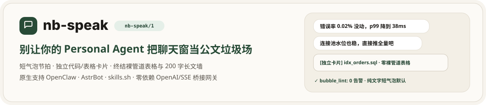
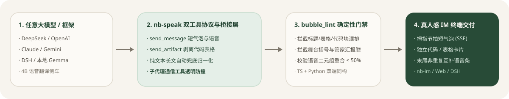

<div align="center">

<picture>
  <source media="(prefers-color-scheme: dark)" srcset="docs/assets/banner-zh-dark.svg">
  
</picture>

**通用 `send_message` + `send_artifact` IM 短气泡协议、DeepSeek Harness (`DSH`) 原生真气泡插件、零依赖 OpenAI/SSE 桥接网关、ElevenLabs `eleven_v4` 贴麦语音与 `chat-human` Agent Skill。**

[](https://github.com/NB-Corp/nb-speak/actions/workflows/ci.yml)
[](https://nodejs.org/)
[](https://www.python.org/)
[](LICENSE)
[](https://nb-corp.github.io/nb-speak/zh/)

[**在线交互试玩 & 点播真声**](https://nb-corp.github.io/nb-speak/zh/) · [30 秒上手](#30-秒极速上手) · [四大实机对决](#同一模型两种体感四大-dsh-实机同题对决) · [协议与流式契约](#协议载荷与-sse-流式契约) · [DSH 插件指南](#deepseek-harness-插件指南-nb-corpnb-speak-dsh) · [bubble_lint 规范](#确定性门禁-bubble_lint-8-大规则规范) · [nb-im](https://github.com/NB-Corp/nb-im)

[English](README.md) · **简体中文**

</div>

主流 AI 对话面板与 Agent 框架至今仍把每次回复当成 300 字 Markdown 论文倾倒进 `assistant.content`——把长 SQL 与宽表格硬塞进狭窄聊天气泡、在周五下班闲聊时甩出四点营养搭配讲义、甚至在语音条里把文字气泡一字不差复读一遍。在 **NB-Corp** 工具矩阵中（[nb-search](https://github.com/NB-Corp/nb-search) 发现、[nb-extract](https://github.com/NB-Corp/nb-extract) 精读、[nb-hub](https://github.com/NB-Corp/nb-hub) 唤醒、[nb-im](https://github.com/NB-Corp/nb-im) 路由），**`nb-speak`** 从协议、插件与确定性门禁三层赋予任意大模型真人手机聊天的呼吸感：

<p align="center">
  <a href="https://nb-corp.github.io/nb-speak/zh/">
    
  </a>
</p>

<p align="center">
  <strong><a href="https://nb-corp.github.io/nb-speak/zh/">点此进入在线交互舞台：切换 5 大真实场景、点播 ElevenLabs <code>eleven_v4</code> 真声并放大检视 DSH 实拍图 → nb-corp.github.io/nb-speak/zh/</a></strong>
</p>

## 30 秒极速上手

> **零外部依赖 (`v0.2.0`)**：仓库内置预编译 ESM 产物 (`dist/`)，仅需 **Node.js >= 22.19**（推荐 Node 24）与 **Python >= 3.10** 标准库即可直接运行，无需 `npm install` 第三方运行时包。

### 1. 一键安装 `chat-human` Agent Skill（Codex、Claude Code、Kiki、Cursor）

```bash
npx skills add NB-Corp/nb-speak
# 或安装独立技能镜像仓：
npx skills add NB-Corp/chat-human
```

### 2. 一键挂载 DeepSeek Harness (`DSH`) 原生真气泡与语音插件

独立插件仓 **[`NB-Corp/nb-speak-dsh`](https://github.com/NB-Corp/nb-speak-dsh)**（[在线展台 →](https://nb-corp.github.io/nb-speak-dsh/zh/)）支持零克隆一行挂载：

```bash
# 1. 干跑预览改动，再持久化同步至 ~/.dsh/plugins/nb-speak-dsh 并挂载到 web profile
npx --yes github:NB-Corp/nb-speak-dsh --dry-run --profile web
npx --yes github:NB-Corp/nb-speak-dsh --apply --profile web

# 2. 可选：启动 dsh web 时传入 ELEVENLABS_API_KEY，自动合成 eleven_v4 真声供 <audio> 点播
#    （未配置密钥时零报错无缝回退浏览器 Web Speech 朗读）
ELEVENLABS_API_KEY="xi-..." dsh web

# 3. 字节级无损还原卸载（全程绝不读取或修改 .credentials.yaml）
npx --yes github:NB-Corp/nb-speak-dsh --uninstall --profile web
```

### 3. 一行启动本地 OpenAI/SSE 桥接网关或执行 `bubble_lint` 校验

```bash
# 1. 在 DeepSeek / OpenAI / 本地 llama-server 前启动零依赖桥接服务 (http://127.0.0.1:18090)
NB_SPEAK_API_KEY="sk-..." npx --yes github:NB-Corp/nb-speak serve \
  --port 18090 \
  --upstream-url https://api.deepseek.com/v1 \
  --model deepseek-chat \
  --persona calm_sre

# 2. 对外发载荷执行确定性 bubble_lint 门禁校验（0 告警返回退出码 0）
echo '{"bubbles":["错误率 0.02% 没动，p99 降到 38ms","连接池水位也稳，直接推全量吧"]}' \
  | node packages/core/bin/nb-speak.mjs lint --json

# 3. 将原始大模型 Markdown + SQL 长文自动归一化为短气泡与独立制品卡片
printf 'Bubble 1: 慢查询定位到了。\n\n```sql\n-- fix.sql\nSELECT 1;\n```\n\n直接跑迁移就行。\n' \
  | node packages/core/bin/nb-speak.mjs parse
```

## 同一模型、两种体感：四大 DSH 实机同题对决

以下四组对比均在隔离双实例 DeepSeek Harness 上由同一模型 **`cmd/deepseek-v4.1-flash`** 真实跑出（左 `:19081` 原生模式 vs 右 `:19082` `@nb-corp/nb-speak-dsh` 原生插件 + ElevenLabs `eleven_v4` 真声，零 Mock）：

| 真实实测场景 | 原生 DSH (`:19081` · 单块 `assistant.content`) | 挂载 `nb-speak` (`:19082` · `send_bubble` + `send_artifact`) |
| --- | --- | --- |
| **1. 周五下班日常闲聊**<br>*“站在便利店冰柜前纠结吃啥，脑子已经转不动了”* | 甩出「一条铁律」+ **4 项加粗营养搭配清单**（关东煮/便当/三明治/泡面）+ 味觉钝化生理科普 + 管家式追问。 | **3 条松弛朋友短气泡**（`别纠结了，直接拿关东煮加一个饭团` / `热的、有咸味、碳水管饱，脑子不用参与` / `柜里没有的话报一下有啥，我秒选`）+ **4.5 秒 ElevenLabs `Jessica` 贴麦真声**（*“先抓热乎的。吃完这顿，周末才算真的开始。”*），**零代码卡，彻底去 AI 味**。 |
| **2. 420 万行慢 SQL 救火**<br>*“orders 倒序分页飙到 4.2 秒，白天主库不能锁表，怎么救”* | 多级标题分段 + 编号排查清单 + 塞在聊天气泡里的长段 `EXPLAIN` SQL 代码围栏。 | **3 条平辈排障结论**（`先别加机器，八成是深 OFFSET 加缺复合索引` / `白天直接跑 CONCURRENTLY 建索引，读写不阻塞` / `深翻页换游标，顺手把 count(*) 停掉`）+ **8 秒 `Julia` 沉稳语音叮嘱** + 可展开/一键复制的 **`orders-pagination-fix.sql`** 卡片。 |
| **3. 多文件工单看板修 Bug**<br>*“修双计时器泄漏 + 顶部实时 `MM:SS` + 松针绿呼吸点 + 筛选胶囊”* | **13/13 测试通过**，但改完 9 个文件后倾倒整屏逐文件改动邀功报告墙。 | **17/17 测试全绿（工程能力零折损）**，仅发 **4 条干脆气泡** + 贴麦语音补充秒表不中断细节 + **`board.css`** 样式卡片。 |
| **4. 傲娇女友并发死锁救援**<br>*相同女友 `AGENTS.md`：第 1 轮暴雨忘带伞 -> 第 2 轮修死锁 Python LRU* | 第 1 轮勉强维持口吻，**第 2 轮一碰并发代码瞬间破功**，退化为 10 段互斥锁原理讲义。 | **全程 100% 稳住微信短句人设与硬核交付**：嘴硬关心短句（`借伞挺大方，写代码倒是先把自己锁死了`）+ `Jessica` 冷幽默语音条 + 32 线程压测通过的 **`ttl_lru.py`** 卡片。 |

<details>
<summary><strong>点击展开：多文件看板挑战 (17/17 全绿) 与女友并发死锁救援完整同屏实拍图</strong></summary>

<br>

<p align="center">
  
</p>

<p align="center">
  
</p>

</details>

## 架构流程与协议契约

<p align="center">
<picture>
  <source media="(prefers-color-scheme: dark)" srcset="docs/assets/workflow-zh-dark.svg">
  
</picture>
</p>

### 协议载荷与 SSE 流式契约

`@nb-corp/nb-speak` (`packages/core`) 从协议层把「手机拇指聊天的短节拍」与「代码/SQL/表格重内容」拆分为两个正交工具调用，兼容任意 OpenAI、DeepSeek、Anthropic Claude、Google Gemini 与本地 Gemma 模型。

#### 1. `send_message` 与 `send_artifact` 线级 JSON 载荷

**`send_message`（1–4 条短气泡 + 可选末尾互补语音条 + 引用锚点）**：

```json
{
  "bubbles": [
    "错误率 0.02% 没动，p99 降到 38ms",
    "连接池水位也稳，直接推全量吧"
  ],
  "voice_note": {
    "text": "大盘安安静静跑了快半小时。你那边点完发布就能收工下班了。",
    "emotion": "calm"
  },
  "reply_to": "msg_94810",
  "end_turn": true
}
```

**`send_artifact`（剥离代码、SQL、Diff 补丁或 Markdown 表格至独立卡片）**：

```json
{
  "title": "idx_orders_tenant_created.sql",
  "kind": "code",
  "language": "sql",
  "content": "CREATE INDEX CONCURRENTLY IF NOT EXISTS idx_orders_tenant_created\n  ON orders (tenant_id, created_at DESC)\n  WHERE deleted_at IS NULL;"
}
```

- **自然打字节拍推算 (`computeBubbleSchedule`)**：首条气泡固定 `240ms` 阅读反应延迟，后续气泡按 `190ms + 42ms × 汉字数 + 56ms × 英文词数 + 75ms × 停顿标点数` 推算拇指输入耗时（钳位在 `[360ms, 2100ms]`），输出逐条 `{ index, text, delayMs, typingDurationMs, cumulativeMs }`。
- **纯文本长文自动兜底 (`normalizeTurnOutput`)**：当上游模型未发起工具调用而直接吐出普通文本时，解析器自动抽离 ```` ```lang ```` 代码块与 `|---|` 管道表格转为 `artifacts`，按 `\n\n` 切分微节拍（保留快递柜号+取件码等双行复制单元），剥除泄漏的 `Bubble 1:` 前缀与短句句号，并将超过 4 泡或超长说明自动外置为 `markdown` 制品卡。

#### 2. 流式 SSE 事件契约与标准 OpenAI `delta.content` 兼容模式

`nb-speak serve` 的 `POST /v1/chat/completions` 同时支持**结构化 IM 事件流**与**零改造 OpenAI 客户端兼容流**：

- **结构化事件模式**（请求头带 `x-nb-speak-events: structured` 或请求体带 `"speak_stream": true`）：抑制原始碎片化 JSON 块，直接按序推送带类型的 `nb.*` SSE 事件：

```text
event: nb.artifact
data: {"type":"nb.artifact","index":0,"artifact":{"title":"auth-canary-25m.sql","kind":"code","language":"sql","content":"SELECT ..."}}

event: nb.bubble
data: {"type":"nb.bubble","index":0,"text":"错误率 0.02% 没动，p99 降到 38ms","delayMs":240,"typingDurationMs":880,"cumulativeMs":240}

event: nb.bubble
data: {"type":"nb.bubble","index":1,"text":"连接池水位也稳，直接推全量吧","delayMs":786,"typingDurationMs":786,"cumulativeMs":1026}

event: nb.voice_note
data: {"type":"nb.voice_note","voice_note":{"text":"大盘安安静静跑了快半小时。你那边点完发布就能收工下班了。","emotion":"calm"}}

event: nb.lint
data: {"type":"nb.lint","lint":{"ok":true,"issueCount":0,"errorCount":0,"warningCount":0,"stats":{"bubbleCount":2,"totalCjkChars":26,"totalEnWords":5,"hasVoiceNote":true,"ttsOverlap":0.0},"issues":[]}}

event: nb.done
data: {"type":"nb.done","turn":{"source":"tool_calls","bubbles":["..."],"artifacts":[...],"end_turn":true,"schedule":[...],"lint":{...}}}

data: [DONE]
```

- **标准 OpenAI 兼容模式**（默认不带 `x-nb-speak-events` 头）：流式请求原样透传上游标准 `data: {"choices":[{"delta":{"content":...}}]}` 增量帧并在流尾附带 `nb.*` 事件与 `data: [DONE]`；非流式请求（`stream: false`）保留完整 `choices[0].message` 并额外挂载顶层 `nb_speak` 归一化对象，现有 OpenAI SDK、`OpenWebUI` 与 `LobeChat` 无需改一行代码即可直连。

## DeepSeek Harness 插件指南 (`@nb-corp/nb-speak-dsh`)

[`packages/dsh-plugin`](packages/dsh-plugin)（同步发布为独立仓库 **[`NB-Corp/nb-speak-dsh`](https://github.com/NB-Corp/nb-speak-dsh)** · **[`nb-corp.github.io/nb-speak-dsh/zh/`](https://nb-corp.github.io/nb-speak-dsh/zh/)**）为 DeepSeek Harness (`DSH`) 提供全栈原生 Cordis 宿主插件与 WebUI 前端气泡扩展 (`exports["./client"]`)。完整架构与配置说明请查阅独立仓库文档 [**`NB-Corp/nb-speak-dsh` README →**](https://github.com/NB-Corp/nb-speak-dsh/blob/main/README.zh-CN.md)。

### 1. 三种运行模式：`native`（默认） · `skill` · `voice-model`

| 对比项 | `native`（默认：原生双工具 + WebUI 气泡） | `skill`（OpenAI 桥接 Mode A） | `voice-model`（4B 语音侧车 Mode B） |
| --- | --- | --- | --- |
| **适用模型** | 直连 DSH 已配置的任意模型渠道（`deepseek`、`cmd/deepseek-v4.1-flash`、OpenAI、Claude、Gemini） | 外部或代理转发的 OpenAI 兼容端点 | 专用分阶段模型或 `<0.8s` 4B 语音翻译侧车（`http://127.0.0.1:18088/v1`） |
| **前端与工具行为** | 注册原生 `send_bubble`（`exec.concludeTurn()` 单步结轮）与 `send_artifact` 工具；`dist/client.js` 在折叠摘要外直接渲染圆角 IM 气泡、22 柱可播放 `<audio>`/Web Speech 语音胶囊与一键复制代码/SQL/Diff/表格卡片 | 在 HTTP 桥接层注入 `send_message` + `send_artifact` 并解包为文本段 | 将 5 轴连续权重编码为 `nb-speak-voice-v1\|w0,w1,w2,w3,w4`，通过 `BubbleStreamFormatter` 扩展口语换行 |
| **推荐场景** | 零代理中转、原生 DSH 气泡与 ElevenLabs `eleven_v4` 真声交互、保留 100% 真实轨迹与缓存统计 | 非 WebUI 的通用 OpenAI 客户端接入 | 高频实时陪伴或需要连续 LoRA/Steering 混音控制的生产网关 |

### 2. 可选 ElevenLabs `eleven_v4` 真声合成与无密钥无缝回退

在默认的 `native` 模式下，`send_bubble` 原生支持可选的高保真语音合成且绝不污染大模型上下文 Token：
- 当检测到 `ELEVENLABS_API_KEY`（或通过 `NB_SPEAK_TTS_BRIDGE` 挂载本地 JSON 语音桥接器）时，`send_bubble` 自动调用 ElevenLabs `eleven_v4` 合成贴麦语音（中文场景对 `Jessica`/`Sarah` 自动注入 `language_code: "zh"` 与静默 `[Standard Mandarin accent]` 锚点防止粤语漂移），在给模型的 `render()` 返回值中剥离音频数据避免消耗 Token，并通过 `presentationMeta` 将音频流直传前端 `VoiceNotePill` `<audio>` 原生播放；
- 当外部开源用户未配置任何语音密钥时，`VoiceNotePill` 自动无感回退至浏览器 Web Speech 朗读与 22 柱波形动画，零外部硬依赖、零报错泄漏。

### 3. 子代理零冲突与五轴连续风格预算

- **子代理工具零碰撞**：`native` 模式使用独立的 `send_bubble` + `send_artifact` 面向人类收束对话，DSH 内置 `@deepseek-ai/dsh-tool-subagent-control` 的 `send_message({ agent_id, message })` 原样保留；桥接模式则自动执行 `send_message <-> agent_send_message` 双向无损重映射。
- **五轴连续风格混音**：支持 `neutral_peer`、`sharp_lead`、`warm_companion`、`calm_sre` 四档预设、`customSoul` 自定义 `SOUL.md` 覆盖，以及 `clarity` (`w0`)、`warmth` (`w1`)、`sharp_wit` (`w2`)、`calm_grounding` (`w3`)、`concise_cadence` (`w4`) 连续滑条（当 `w1..w4` 之和超过 `1.15` 时自动等比缩放防过饱和）。

## 确定性门禁：`bubble_lint` 8 大规则规范

TypeScript 版 `lintTurn()` (`packages/core/src/lint.ts`) 与零依赖 Python 版 `skills/chat-human/scripts/bubble_lint.py` 保持 100% 规则同构，在 DeepSeek 与 GPT 多轮评测中实测达到 **`97.2%–100%` 零八股通过率**：

| # | 规则域 | 错误 / 告警码 | 级别 | 精确判定阈值与触发条件 |
| --- | --- | --- | --- | --- |
| 1 | **气泡数量与空载荷门禁** | `bubble.empty`<br>`bubble.too_many` | `error` | 无非空文字且无语音条时报错；`bubbles[]` 协议单轮上限 **`4` 条**（传统 `messages[]` 默认上限 **`3` 条**，可通过 `--max-bubbles` 覆盖）。 |
| 2 | **手机拇指阅读字数预算** | `bubble.over_cjk_budget`<br>`bubble.over_en_budget` | `warning` | 单轮全部气泡累计汉字 `> 55` 字（默认 `--max-cjk-chars 55`）或英文词数 `> 45` 词（默认 `--max-en-words 45`）时告警，提示精简或外置到 `send_artifact`。 |
| 3 | **气泡内禁混排 Markdown 结构墙** | `bubble.markdown_structure` | `error` | 气泡正文出现 `#` 标题、`\|---\|` 管道表格、```` ``` ```` 代码围栏、`- **加粗**：` 列表墙或 `1. ... 2. ...` 编号墙时直接拦截。 |
| 4 | **短句与取件码禁挂正式句号** | `style.trailing_period` | `warning` | 单子句短气泡（汉字 `<= 22` 且英文 `<= 6`，或纯英文 `<= 12` 词）以 `。` / `.` 结尾、4 位以上字母数字码后紧贴句号（如 `663920。`）、或 `>= 2` 条气泡每条都以句号结尾时告警。 |
| 5 | **禁剧本括号、管家腔与语气词刷屏** | `style.stage_brackets`<br>`style.steward_cliche`<br>`style.particle_spam` | `error` / `warning` | 出现 `*sighs*`、`（叹气）`、`（叉腰）` 等舞台括号报 `error`；出现 `向你汇报`、`请检阅`、`顺手替你`、`for your review`、`hope this helps` 报 `warning`；`>= 2` 条气泡中超过 `50%` 以 `啦` 结尾报 `warning`。 |
| 6 | **Emoji 策略与元数据/报错防泄漏** | `style.unicode_emoji`<br>`plain.meta_leak`<br>`style.placeholder_leak`<br>`style.system_error_leak` | `error` / `warning` | 默认 `--persona-emoji deny` 下出现 Unicode Emoji 报 `warning`；纯文本流裸露 `{"bubbles":...}` / `气泡1：`、未渲染的 `{{user}}` 占位符、或泄漏「语音合成插件未配置」等后端报错均报 `error`。 |
| 7 | **单轮单条末尾语音挂载约束** | `tts.batch_root_duplication`<br>`tts.multiple_clips`<br>`tts.not_on_final_bubble` | `error` / `warning` | 单轮超过 `1` 条语音或 `messages[]` 多泡批次顶层误挂 `tts`/`voice_mode` 报 `error`；语音条未挂在最后一条气泡上报 `warning`。 |
| 8 | **图文二元组去重与口语数字规范** | `tts.verbatim_overlap`<br>`tts.raw_path_or_url`<br>`tts.unnormalized_numbers` | `error` / `warning` | 语音文本与文字气泡的**有向字符二元组重合度 `> 50%`**（复读文字泡）报 `error`；语音含裸 URL 或文件路径报 `error`；含未转口语的小数或时间冒号（如 `19.9`、`14:30`）报 `warning`。 |

## 实战集成配方

### 配方 1：配合 `@nb-corp/nb-im` 实现多平台带节奏分泡发送 + 末尾语音条

```ts
import { setTimeout as sleep } from 'node:timers/promises';
import { normalizeTurnOutput } from '@nb-corp/nb-speak';

export async function deliverSpeakTurn(session, target, rawCompletion, synthesizeTts, abortSignal) {
  const turn = normalizeTurnOutput(rawCompletion, { cleanHygiene: true });

  for (const art of turn.artifacts) {
    await session.send(
      {
        type: 'file',
        target,
        filename: art.title,
        bytes: new TextEncoder().encode(art.content),
        mime_type: 'text/plain; charset=utf-8',
      },
      abortSignal,
    );
  }

  for (const beat of turn.schedule) {
    await sleep(beat.delayMs, undefined, { signal: abortSignal });
    await session.send({ type: 'text', target, text: beat.text }, abortSignal);
  }

  if (turn.voice_note && synthesizeTts) {
    try {
      const audioBytes = await synthesizeTts(turn.voice_note.text, turn.voice_note.emotion);
      await session.send(
        { type: 'voice', target, bytes: audioBytes, mime_type: 'audio/ogg; codecs=opus' },
        abortSignal,
      );
    } catch {
      // Layer 1 铁律：TTS 失败静默跳过，绝不向用户聊天窗吐出插件报错文本
    }
  }
}
```

### 配方 2：主力推理大模型 + 本地 4B 语音翻译侧车 (`--voice-sidecar-url`)

```bash
# 终端 1：启动本地 4B 语音翻译侧车（例如 llama-server OpenAI 兼容端口 18088）
llama-server -m ./models/voice-translator-4b-q4_k_m.gguf --port 18088

# 终端 2：启动 nb-speak 桥接网关，串联云端推理主模型与本地 4B 侧车
NB_SPEAK_API_KEY="sk-..." node packages/core/bin/nb-speak.mjs serve \
  --port 18090 \
  --upstream-url https://api.deepseek.com/v1 \
  --model deepseek-reasoner \
  --voice-sidecar-url http://127.0.0.1:18088/v1
```

## 可插拔人设架构：一套物理节奏，适配任意声音

Layer 1 负责全场景通用的手机发消息物理直觉，Layer 2 按严格优先级解析语气距离：

1. **当前轮用户显式指令**（例如*“帮我拟一条发给李总的微信，带握手表情”*）
2. **激活人设 / `SOUL.md` / 系统提示词**（内置 `neutral_peer` 平等技术搭档、`sharp_lead` 干练技术负责人、`warm_companion` 熟稔日常伙伴、`calm_sre` 沉稳值班 SRE，或挂载任意自定义 `SOUL.md`）
3. **会话场域上下文**（1v1 私聊 vs. 团队工作群）
4. **默认平等技术搭档基线**（干脆自然、零自作多情角色扮演、零 Emoji 轰炸、零卑微客服套话）

## 仓库目录与测试验证

```text
nb-speak/
├── packages/
│   ├── core/                # @nb-corp/nb-speak：双工具协议、流解析器、TS bubble_lint、HTTP/SSE 桥接与 CLI
│   └── dsh-plugin/          # @nb-corp/nb-speak-dsh：DSH 原生双工具、ElevenLabs/WebSpeech 气泡前端与安装器
├── skills/
│   └── chat-human/          # 通用 chat-human 技能 (v0.2.0) + bubble_lint.py + proactive_gate.py
├── apps/
│   └── web/                 # 纸墨触感 IM 同屏对比工作台源码（同步构建至 docs/）
├── docs/                    # GitHub Pages 双语工作台、ElevenLabs v4 真声样本与 DSH 实机实拍资产
├── llms.txt                 # 面向生成式搜索引擎的精简索引 (llmstxt.org)
└── llms-full.txt            # 完整协议 Schema、定量指标、对比矩阵与高频工程问答
```

运行全量构建与单元验证套件（纯 Node.js + Python 标准库，零外部依赖）：

```bash
npm test
```

## 开源协议

[MIT](LICENSE) © 2026 NB-Corp —— 适用于本仓库全部源码、协议 Schema、CLI 工具、DSH 插件、`chat-human` 技能与文档。

**示例语音资产与 AI 标识说明**：[`apps/web/src/assets/audio/`](apps/web/src/assets/audio/NOTICE.txt)（同步至 `docs/assets/audio/`）中的静态 `.mp3` 示例语音条（中英文全量）均由 ElevenLabs (`eleven_v4`) 基于官方预置合成声线（`Jessica`、`Sarah`、`Julia`、`ZiYue`、`ShanShan`）生成并校准至 `-16 LUFS`（未克隆任何自然人声纹），仅用于在线体验页演示 `nb-speak` 互补语音胶囊；依据上游服务条款，相关音频不可提取用于训练竞品语音合成模型，亦不得冒充真人录音传播。
