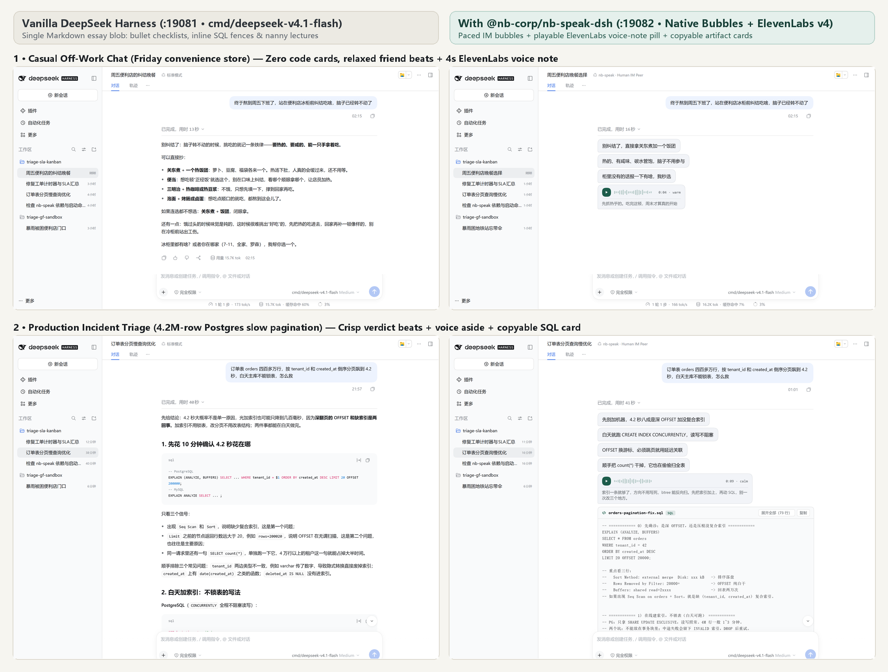
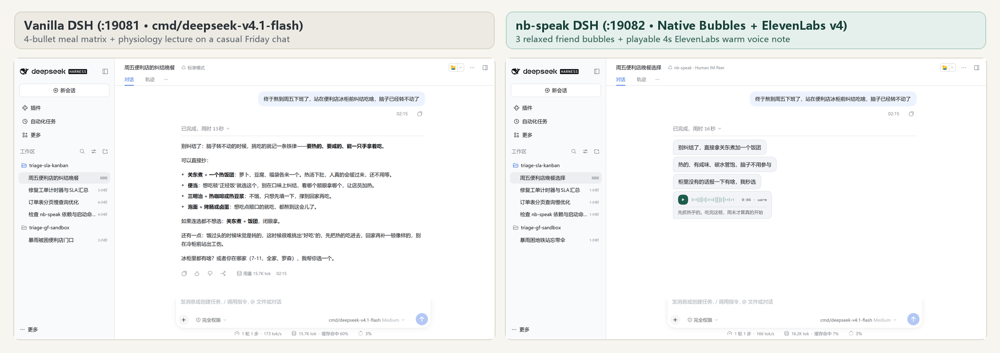
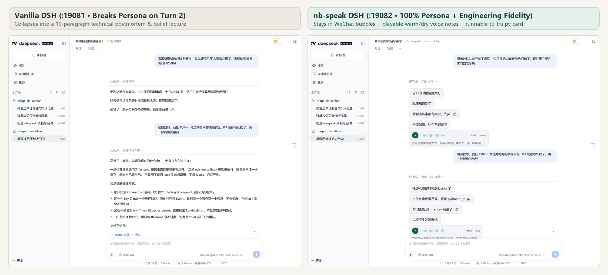

# `@nb-corp/nb-speak-dsh`

Full-stack DeepSeek Harness (`DSH`) Cordis plugin and WebUI client extension for [`NB-Corp/nb-speak`](https://github.com/NB-Corp/nb-speak). Replaces single-blob Markdown essays in DSH with tactile IM chat bubbles, playable 22-bar ElevenLabs `eleven_v4` / Web Speech voice-note pills, and collapsible one-click copyable artifact cards—with zero runtime npm dependencies and zero subagent tool collisions.

**[Try the Interactive Split-Stage & Play Live Voice Notes → `nb-corp.github.io/nb-speak/`](https://nb-corp.github.io/nb-speak/)** · **[中文工作台 → `/zh/`](https://nb-corp.github.io/nb-speak/zh/)**

<p align="center">
  <a href="https://nb-corp.github.io/nb-speak/zh/">
    
  </a>
</p>

## 30-Second Installation & Reversible Uninstall

`scripts/install-dsh.mjs` snapshots your profile files to `<DSH_HOME>/.nb-speak-backup/<profile>.json` before writing and **never reads, modifies, or deletes `.credentials.yaml`**:

```bash
# 1. Dry-run preview (zero filesystem writes)
node packages/dsh-plugin/scripts/install-dsh.mjs --dry-run --profile web

# 2. Apply Native Mode (default) to your active DSH web profile
node packages/dsh-plugin/scripts/install-dsh.mjs --apply --profile web --preset neutral_peer

# 3. Or test inside an isolated --dsh-home sandbox without touching ~/.dsh
node packages/dsh-plugin/scripts/install-dsh.mjs --apply \
  --dsh-home .tmp/dsh-sandbox \
  --profile web \
  --preset calm_sre

# 4. Byte-for-byte reversible uninstall
node packages/dsh-plugin/scripts/install-dsh.mjs --uninstall --profile web
```

## How Native Mode Works Under the Hood (`runtimeMode: "native"`)

1. **First-Class `send_bubble` + `exec.concludeTurn()`**:
   - Registers `send_bubble` and `send_artifact` directly on DSH's `tools` service (`src/dsh-tools.ts`) and injects the `nb-speak:protocol` prompt contract at order `9200` (`dsh-system-prompt`).
   - Workspace tools (`read`, `glob`, `grep`, `edit`, `write`, `pwsh`/`bash`) execute directly without proxy hops. When all workspace actions finish, the model calls `send_bubble` (alongside `send_artifact` if sharing code/SQL/diffs/tables), which invokes `exec.concludeTurn()` to end the turn cleanly in one step with zero duplicate `assistant.content` prose.
2. **Collision-Free Subagent Orchestration**:
   - Because user-facing turns use `send_bubble` + `send_artifact`, DSH's `@deepseek-ai/dsh-tool-subagent-control` `send_message({ agent_id, message })` remains 100% untouched for parent-to-child subagent communication.
   - In optional HTTP bridge modes (`skill` / `voice-model`), `src/tool-remap.ts` bidirectionally remaps DSH's internal `send_message <-> agent_send_message` on every request and response.
3. **WebUI Client Surface (`dist/client.js`)**:
   - Registers a turn-level event reducer (`nbSpeakTurnDefinition`) and mounts into `conversation.chat.turnTail` outside collapsed tool-step summaries.
   - Renders organic squircle chat bubbles, deterministic 22-bar waveform `VoiceNotePill` players, and syntax-badged `ArtifactCardView` blocks (supporting GFM pipe-table HTML rendering, diff line coloring, `>22`-line expand/collapse, and clipboard copy).

## Optional ElevenLabs `eleven_v4` Audio + Zero-Config Fallback

`@nb-corp/nb-speak-dsh` plays voice notes out of the box for every user while upgrading automatically when ElevenLabs credentials or a local TTS bridge are present (`src/tts.ts`):

| Environment / Config | Audio Synthesis Path | LLM Token Impact |
| --- | --- | --- |
| **Default (no TTS key)** | Instant `0ms` tool completion; `VoiceNotePill` plays via browser **Web Speech API** + animated 22-bar progress (`data-audio-mode="web-speech"`). | `0` extra tokens |
| **`ELEVENLABS_API_KEY` set** (or DSH credential store ref `ttsApiKeyRef`) | Calls ElevenLabs `eleven_v4` (`mp3_44100_128`); auto-selects `Jessica` (`warm`/`playful`/`relieved`) or `Julia` (`calm`/`dry`/`serious`) unless overridden by `ttsVoice` / `NB_SPEAK_TTS_VOICE`, and auto-injects `language_code: "zh"` + `[Standard Mandarin accent]` on Mandarin turns to eliminate Cantonese prosody drift. | **`0` extra tokens** (`render()` strips `audioSrc` DataURI; only WebUI `presentationMeta` receives `<audio>` data) |
| **`NB_SPEAK_TTS_BRIDGE` set** (or `ttsBridgeScript` config) | Invokes a local JSON TTS bridge script (`{ action: "submit", input, output, resultFile }`) for custom EBU R128 `-16 LUFS` mastering or multi-key pools. | **`0` extra tokens** |

```bash
# Launch DSH WebUI with live ElevenLabs eleven_v4 voice-note synthesis enabled:
ELEVENLABS_API_KEY="xi-..." NB_SPEAK_TTS_VOICE="Jessica" dsh web
```

## Four Built-In Presets & 5-Axis Continuous Style Budget

Configure via DSH Settings (`nb-speak` Schemastery panel) or `cordis.patch.yml`:

| Preset ID | Default Vector `[w0, w1, w2, w3, w4]` | Voice Register |
| --- | --- | --- |
| `neutral_peer` *(default)* | `[1.00, 0.20, 0.10, 0.20, 0.30]` | Equal-footing engineering teammate—candid, relaxed, zero corporate servility |
| `sharp_lead` | `[1.10, 0.10, 0.35, 0.20, 0.40]` | Crisp tech lead—verdict first, dry understatement, zero filler |
| `warm_companion` | `[0.95, 0.75, 0.20, 0.15, 0.05]` | Attentive everyday friend/partner texting from a phone—natural warmth, zero checklists |
| `calm_sre` | `[1.15, 0.10, 0.05, 0.55, 0.35]` | On-call incident responder—steady root cause, live impact, lock-free commands in cards |

When `preset: "custom"` is selected and `w1 + w2 + w3 + w4 > 1.15`, `computeEffectiveWeights()` scales `w1..w4` proportionally to keep the L1 style filter budget `<= 1.15`. Workspace `AGENTS.md` personas (such as character or domain roles) harmonize automatically on top of `send_bubble`.

## Live Dual-Instance DSH Captures (`:19081` Vanilla vs `:19082` `nb-speak`)

### 1. Casual Friday Off-Work Chat (Zero Code Cards + 4s ElevenLabs Voice Note)

<p align="center">
  
</p>

### 2. Multi-File Kanban & Live SLA Timer Bugfix (`17/17` Tests Green)

<p align="center">
  
</p>

### 3. Tsundere Girlfriend Persona + Thread-Safe Python `ttl_lru.py`

<p align="center">
  
</p>

## Verification

```bash
npm run test:dsh
```

## License

[MIT](./LICENSE) © 2026 NB-Corp
