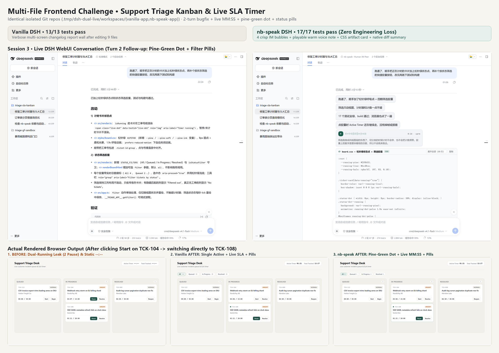

# `@nb-corp/nb-speak-dsh`

Full-stack DeepSeek Harness (`DSH`) Cordis plugin and WebUI client extension—also published as the standalone zero-clone repository **[`NB-Corp/nb-speak-dsh`](https://github.com/NB-Corp/nb-speak-dsh)** for [`NB-Corp/nb-speak`](https://github.com/NB-Corp/nb-speak). Replaces single-blob Markdown essays in DSH with tactile IM chat bubbles, collapsible one-click copyable artifact cards, and optional 22-bar voice-note pills (`enableVoiceNotes: false` by default)—with zero runtime npm dependencies and zero subagent tool collisions.

**[Standalone DSH Showcase → `nb-corp.github.io/nb-speak-dsh/`](https://nb-corp.github.io/nb-speak-dsh/)** · **[中文展台 → `/zh/`](https://nb-corp.github.io/nb-speak-dsh/zh/)** · **[Protocol Playground → `nb-corp.github.io/nb-speak/`](https://nb-corp.github.io/nb-speak/)**

<p align="center">
  <a href="https://nb-corp.github.io/nb-speak/zh/">
    
  </a>
</p>

## 30-Second Installation & Reversible Uninstall

`scripts/install-dsh.mjs` snapshots your profile files to `<DSH_HOME>/.nb-speak-backup/<profile>.json` before writing and **never reads, modifies, or deletes `.credentials.yaml`**:

```bash
# 1. Zero-clone dry-run preview from the standalone repo (zero filesystem writes)
npx --yes github:NB-Corp/nb-speak-dsh --dry-run --profile web

# 2. Apply Native Mode (persists ~/.dsh/plugins/nb-speak-dsh & mounts into web profile)
npx --yes github:NB-Corp/nb-speak-dsh --apply --profile web

# 3. Byte-for-byte reversible uninstall
npx --yes github:NB-Corp/nb-speak-dsh --uninstall --profile web

# Or run directly from a local nb-speak monorepo checkout (--link skips copying):
node packages/dsh-plugin/scripts/install-dsh.mjs --apply --link --profile web
```

## How Native Mode Works Under the Hood (`runtimeMode: "native"`)

1. **First-Class `send_bubble` + `exec.concludeTurn()`**:
   - Registers `send_bubble` and `send_artifact` directly on DSH's `tools` service (`src/dsh-tools.ts`) and injects the `nb-speak:protocol` prompt contract at order `9200` (`dsh-system-prompt`).
   - Workspace tools (`read`, `glob`, `grep`, `edit`, `write`, `pwsh`/`bash`) execute directly without proxy hops. When all workspace actions finish, the model calls `send_bubble` (alongside `send_artifact` if sharing code/SQL/diffs/tables), which invokes `exec.concludeTurn()` to end the turn cleanly in one step with zero duplicate `assistant.content` prose.
2. **Collision-Free Subagent Orchestration**:
   - Because user-facing turns use `send_bubble` + `send_artifact`, DSH's `@deepseek-ai/dsh-tool-subagent-control` `send_message({ agent_id, message })` remains 100% untouched for parent-to-child subagent communication.
   - In optional HTTP bridge modes (`skill` / `voice-model`), `src/tool-remap.ts` bidirectionally remaps DSH's internal `send_message <-> agent_send_message` on every request and response.
3. **WebUI Client Surface (`dist/client.js`)**:
   - Registers a turn-level event reducer (`nbSpeakTurnDefinition`) and mounts into `conversation.chat.turnTail` outside collapsed tool-step summaries.
   - Renders organic squircle chat bubbles, deterministic 22-bar waveform `VoiceNotePill` players, and syntax-badged `ArtifactCardView` blocks (supporting GFM pipe-table HTML rendering, diff line coloring, `>22`-line expand/collapse, and clipboard copy).

## Optional Provider-Agnostic Voice Notes (Off by Default)

`@nb-corp/nb-speak-dsh` defaults to **`enableVoiceNotes: false`** (pure text bubbles and `send_artifact` cards with zero voice prompting or TTS calls). Opt in with `--voice-notes`, `enableVoiceNotes: true`, or `NB_SPEAK_VOICE_NOTES=true`, then configure any speech backend (`src/tts.ts`):

| Environment / Config | Audio Synthesis Path | LLM Token Impact |
| --- | --- | --- |
| **Default (`enableVoiceNotes: false`)** | Text bubbles + copyable `send_artifact` cards only (`voice_note` omitted from schema & prompt). | `0` extra tokens |
| **OpenAI-compatible `/v1/audio/speech`** (`NB_SPEAK_VOICE_NOTES=true` + `NB_SPEAK_TTS_BASE_URL`) | Calls any OpenAI-compatible speech endpoint (OpenAI, Qwen TTS, Fish, Kokoro, vLLM) with `NB_SPEAK_TTS_API_KEY`, `NB_SPEAK_TTS_MODEL`, and `NB_SPEAK_TTS_VOICE`. | **`0` extra tokens** |
| **Local JSON Bridge** (`NB_SPEAK_VOICE_NOTES=true` + `NB_SPEAK_TTS_BRIDGE`) | Invokes a local JSON TTS bridge script (`{ action: "submit", input, output, resultFile }`) for custom EBU R128 `-16 LUFS` mastering or local engines. | **`0` extra tokens** |
| **Cloud TTS / Web Speech Fallback** (`NB_SPEAK_VOICE_NOTES=true`) | Supports optional direct cloud speech adapters (`NB_SPEAK_TTS_PROVIDER`) or falls back automatically to zero-key browser **Web Speech API** (`data-audio-mode="web-speech"`) when unset. | **`0` extra tokens** (`render()` strips `audioSrc` DataURI; only WebUI `presentationMeta` receives `<audio>` data) |

```bash
# Launch DSH WebUI with optional voice notes via any OpenAI-compatible /v1/audio/speech server:
NB_SPEAK_VOICE_NOTES=true NB_SPEAK_TTS_BASE_URL="http://127.0.0.1:8000/v1" dsh web
```

## Four Built-In Presets & 5-Axis Continuous Style Budget

Configure via DSH Settings (`nb-speak` Schemastery panel) or `cordis.patch.yml`:

| Preset ID | Default Vector `[w0, w1, w2, w3, w4]` | Voice Register |
| --- | --- | --- |
| `neutral_peer` *(default)* | `[1.00, 0.20, 0.10, 0.20, 0.30]` | Equal-footing engineering teammate—candid, relaxed, zero corporate servility |
| `sharp_lead` | `[1.10, 0.10, 0.35, 0.20, 0.40]` | Crisp tech lead—verdict first, dry understatement, zero filler |
| `warm_companion` | `[0.95, 0.75, 0.20, 0.15, 0.05]` | Attentive everyday friend/partner texting from a phone—natural warmth, zero checklists |
| `calm_sre` | `[1.15, 0.10, 0.05, 0.55, 0.35]` | On-call incident responder—steady root cause, live impact, lock-free commands in cards |

When `preset: "custom"` is selected and `w1 + w2 + w3 + w4 > 1.15`, `computeEffectiveWeights()` scales `w1..w4` proportionally to keep the L1 style filter budget `<= 1.15`. Workspace `AGENTS.md` personas (such as character or domain roles) harmonize automatically on top of `send_bubble`.

## Live Dual-Instance DSH Captures (`:19081` Vanilla vs `:19082` `nb-speak`)

### 1. Casual Friday Off-Work Chat (Zero Code Cards + Optional 4s Voice Note)

<p align="center">
  
</p>

### 2. Multi-File Kanban & Live SLA Timer Bugfix (`17/17` Tests Green)

<p align="center">
  
</p>

### 3. Tsundere Girlfriend Persona + Thread-Safe Python `ttl_lru.py`

<p align="center">
  
</p>

## Verification

```bash
npm run test:dsh
```

## License

[MIT](./LICENSE) © 2026 NB-Corp
